# Buổi 1: Giới thiệu cài đặt IDE và Extensions
***
## I. Cài đặt IDE, Extensions
---
### 1. IDE
[Visual Studio Code](https://code.visualstudio.com/)
### 2. Extensions
- HTML CSS Support 


- Live Server 


- Auto Close Tag

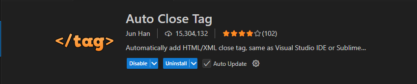

- Auto Rename Tag

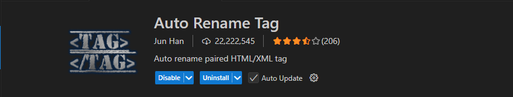

- Các extension tham khảo:

| Tên extension | Tác dụng |
| --- | --- |
| IntelliSense for CSS class names in HTML | Gợi ý và tự động hoàn thành tên class trong HTML dựa trên các class đã khai báo trong CSS. |
| htmltagwrap | Bọc đoạn nội dung đang chọn bằng một thẻ HTML để thao tác nhanh hơn. |
| Path Intellisense | Gợi ý đường dẫn đến file và thư mục khi liên kết ảnh, CSS hoặc JavaScript. |
| Prettier - Code formatter | Tự động định dạng mã HTML, CSS và JavaScript, giúp thống nhất cách thụt lề và trình bày mã. |
| Color Highlight | Hiển thị màu tương ứng ngay tại các mã màu trong CSS để dễ nhận biết và kiểm tra. |
| CSS Peek | Xem nhanh hoặc chuyển đến phần định nghĩa CSS của class và ID từ file HTML. |
| Image preview | Xem trước hình ảnh ngay trong trình soạn thảo khi làm việc với đường dẫn ảnh. |
| JavaScript (ES6) code snippets | Cung cấp các mẫu mã JavaScript viết sẵn, giúp nhập nhanh những đoạn mã thường dùng. |
| ESLint | Phân tích mã JavaScript để phát hiện lỗi và các vấn đề về quy tắc viết mã; cần cấu hình ESLint phù hợp cho dự án. |

## II. Git & GitHub
---
### 1. Git

a. Git là gì? Git là hệ thống quản lý phiên bản phân tán (VCS - Version Control System), giúp bạn theo dõi mọi thay đổi trong mã nguồn của dự án, từ đó có thể phối hợp và làm việc nhóm một cách dễ dàng và hiệu quả

b. Tại sao cần dùng Git

 - Theo dõi sự thay đổi của dự án
 - Dễ dàng quay lại phiên bản trước đó nếu có lỗi
 - Hỗ trợ làm việc nhóm nhiều người trên cùng 1 dự án

c. Khái niệm cơ bản

- Repo (Repository): kho lưu trữ mã nguồn, nơi chứa toàn bộ các file và lịch sử thay đổi của dự án
    - Local repo: Đây là repo được thiết lập trên máy của lập trình viên và dành cho 1 người sử dụng
    - Remote repo: Đây là repo để chia sẻ giữa nhiều người và bố trí trên server chuyên dụng
- Branch: Tương tự như một workspace mới mà không ảnh hưởng tới nhánh chính
- Commit: là hành động ghi lại sự thay đổi trong repo của bạn
- Clone: là hành động tải một bản sao có sẵn của một remote repo server nào đó có sẵn
- Push: là hành động đưa các commit từ local repo lên remote repo

d. Cài đặt Git

1. [Download Git](https://git-scm.com/downloads)

2. Thiết lập thông tin cá nhân của mình với Git

- Mục đích của việc thiết lập thông tin cá nhân trên Git (bao gồm tên và địa chỉ email) là để Git có thể xác định người thực hiện các hành động trong quá trình quản lý phiên bản (version control). Tức là khi thực hiện một commit trong Git, thông tin cá nhân như tên và email sẽ được ghi lại cùng với commit đó.
```bash
git config --global user.name "Tên của bạn"
git config --global user.email "email@example.com"
git config --list
```
3. Các lệnh cơ bản khi dùng `Git`

- Khởi tạo và sao chép
```bash
git init                     # Khởi tạo repo Git mới
git clone <url>              # Sao chép một repo từ GitHub/GitLab...
```
- Theo dõi và thay đổi
```bash
git status                   # Kiểm tra trạng thái file
git add <file>               # Thêm file vào staging area
git add .                    # Thêm tất cả file vào staging
git commit -m "Thông điệp"   # Tạo commit mới
```
- Đẩy và lấy dữ liệu
```bash
git push                     # Đẩy code lên repository 
git push origin main         # Đẩy code lên nhánh main
git pull                     # Kéo code mới nhất từ repo về
```
- Quản lý nhánh (Branch)
```bash 
git branch                   # Liệt kê các nhánh
git branch <ten-nhanh>       # Tạo nhánh mới
git checkout <ten-nhanh>     # Chuyển sang nhánh khác
git checkout -b <ten-nhanh>  # Tạo và chuyển sang nhánh mới
git merge <ten-nhanh>        # Gộp nhánh vào nhánh hiện tại
git branch -d <ten-nhanh>    # Xoá nhánh đã gộp
```
### 2. GitHub
a. GitHub là gì? 
- GitHub là một nền tảng dựa trên web được thiết kế để lưu trữ mã nguồn và hỗ trợ quản lý phiên bản (version control) bằng cách sử dụng Git. Nó cung cấp không gian lưu trữ cho các dự án mã nguồn (repository) và các công cụ để quản lý, theo dõi và làm việc trong các dự án phần mềm. 

b. Liên kết Git và GitHub

- Khi liên kết Git và GitHub, mã nguồn sẽ được lưu trữ online, tức bạn có thể truy cập đến mã nguồn của mình từ bất cứ đâu, chỉ cần có mạng Internet
- Giúp sao lưu dữ liệu tránh trường hợp dữ liệu bị mất hay máy tính hỏng hóc
- Giúp chia sẻ mã nguồn và làm việc nhóm với các công cụ, tính năng giúp kiểm soát mã nguồn, xử lý lỗi
1. Tạo tài khoản GitHub và tạo repo mới
- Sau khi tạo tài khoản để tạo một repo mới làm được nhấn vào button `new` như hình này: 

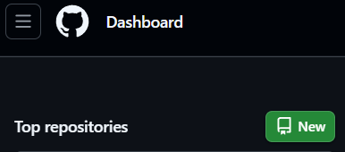

- Sau khi vào trang chính của tạo repo chúng ta đặt tên cho repo chuẩn bị tạo bằng cách nhập tên vào ô `input` như hình: 

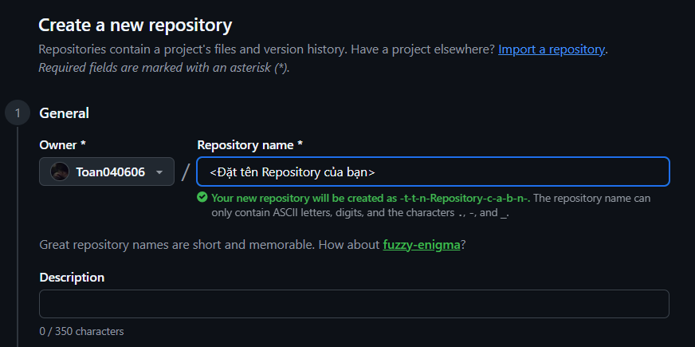

- Cuối cùng kéo xuống dưới và nhấn vào `Create repository`: 


2. Kết nối folder trong máy tính với repo trên GitHub

B1: Tạo một folder bất kỳ trên Laptop 


B2: Click chuột phải vào folder vừa tạo chọn `Show more options` sau đó chọn `Git Bash`:

B3: Sau khi hiển thị bảng như hình 

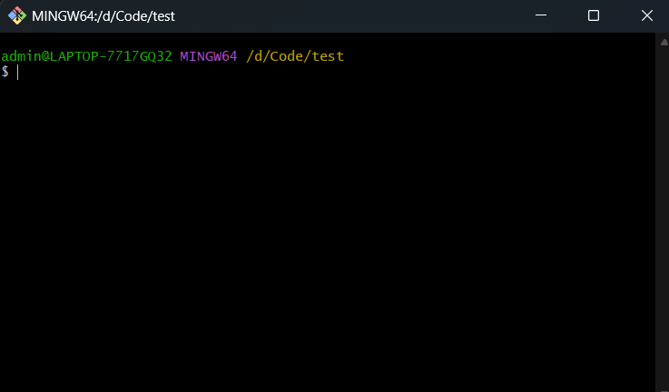

thì chúng ta copy code ở GitHub vào đó 

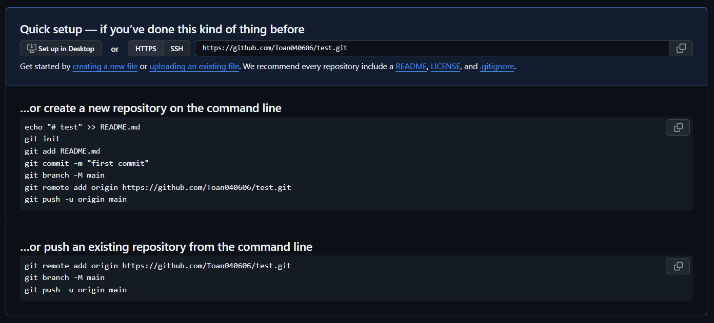 

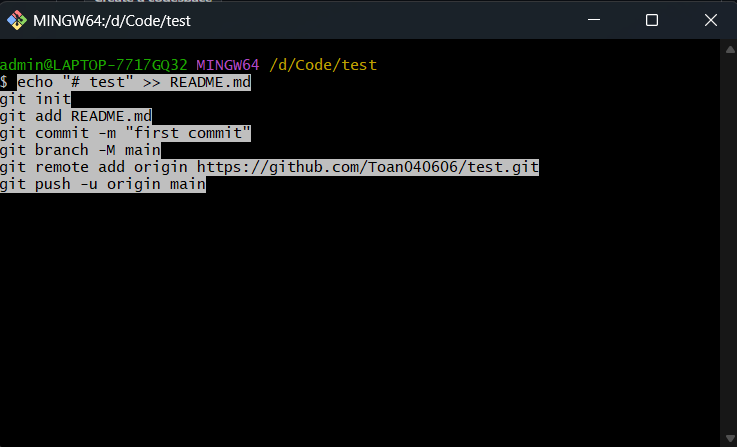 

B4: Sau khi code chạy xong load lại trang ở GitHub

3. GitHub Pages

B1: Mở folder vừa tạo trong VS code.
B2: Tạo một file có tên là `index.html`.
B3: Copy đoạn code sau vào file vừa tạo.

```html
<!DOCTYPE html>
<html lang="en">
<head>
    <meta charset="UTF-8">
    <meta name="viewport" content="width=device-width, initial-scale=1.0">
    <title>Document</title>
</head>
<body>
    <h1>Hello anh em</h1>
</body>
</html>
```

B4: Mở lại Git Bash và gõ lệnh `git add .` và Enter

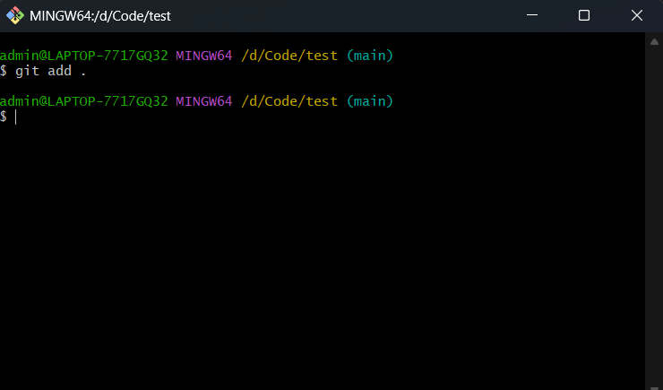

B5: Tiếp theo gõ lệnh `git commit -m "message"` và Enter

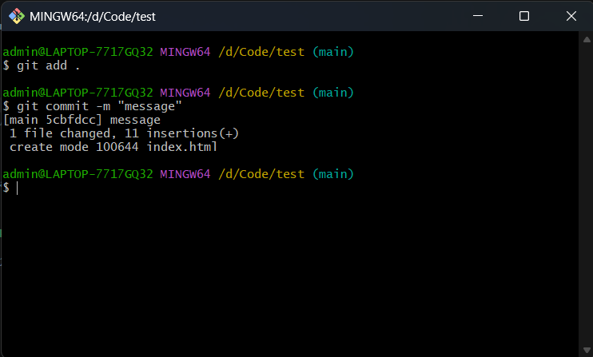

B6: Cuối cùng gõ lệnh `git push origin main` và Enter

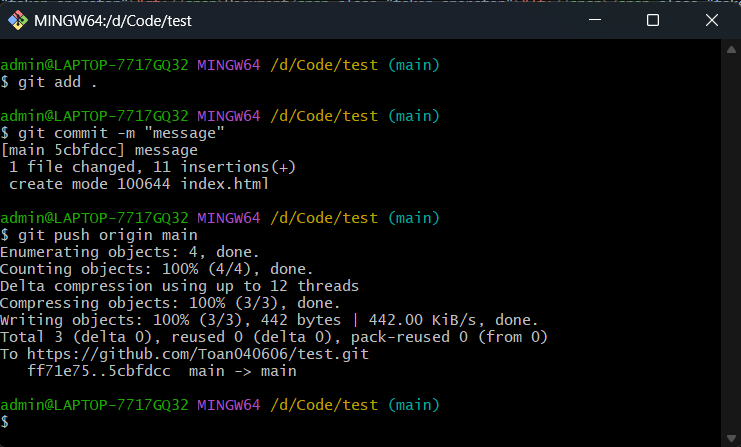

Như vậy là đã thành công, load lại trang GitHub sẽ thấy file index.html đã được tải lên

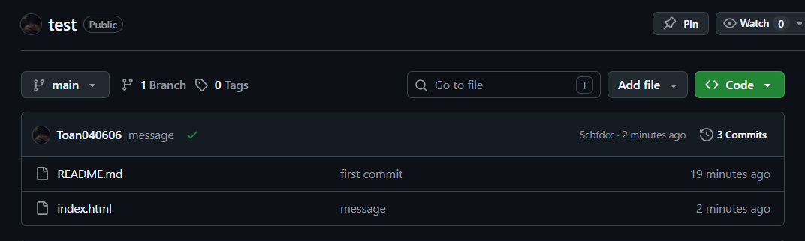

B7: Tiếp tục ở trang GitHub, nhấn vào mục `Settings`

 

B8: Chọn vào phần Pages 

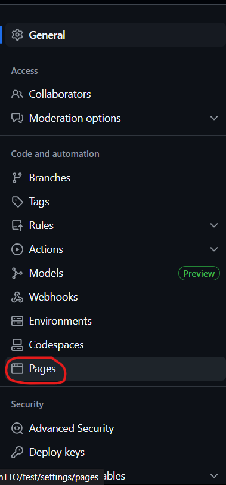

B9: Ở phần `Branch` chọn `main` như ảnh:

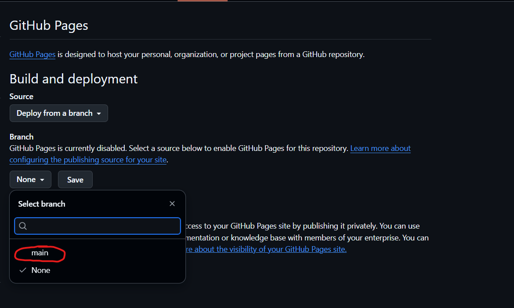

B10: Nhấn vào button `Save` bên cạnh


B11: Đợi 1 lúc sau đó nhấn vào `Visit site`

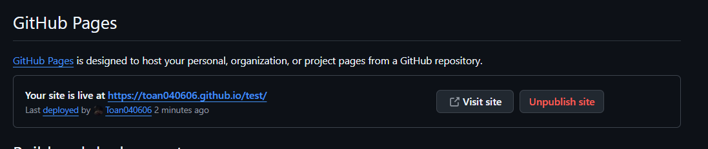

B12: Nếu cần, thêm `index.html` (tên file vừa tạo ở bước 2) vào cuối địa chỉ. Với file `index.html` ở thư mục gốc, trang web thường mở trực tiếp tại đường dẫn GitHub Pages.

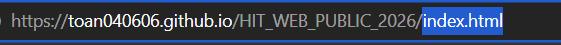

## III. HTML, CSS, JavaScript
---
1. HTML
- HTML (HyperText Markup Language) là ngôn ngữ đánh dấu được sử dụng để tạo cấu trúc và nội dung cho một trang web.
- HTML không phải là ngôn ngữ lập trình mà là ngôn ngữ đánh dấu để sắp xếp các thành phần như văn bản, hình ảnh, liên kết, biểu mẫu, và các nội dung khác trên trang web.

2. CSS
- CSS (Cascading Style Sheets) là ngôn ngữ dùng để mô tả cách hiển thị của các phần tử HTML trên trang web.
- Nó quyết định về bố cục, màu sắc, kiểu chữ, kích thước, khoảng cách giữa các phần tử, v.v. CSS giúp trang web trông trực quan và dễ nhìn hơn.

3. JavaScript (JS)
- JavaScript là ngôn ngữ lập trình dùng để bổ sung các chức năng và tính tương tác cho trang web.
- JavaScript có thể xử lý các sự kiện như nhấn nút, nhập dữ liệu, di chuyển chuột; thay đổi nội dung và giao diện trang web mà không cần tải lại toàn bộ trang.
- Ví dụ: nhấn nút để mở menu, kiểm tra thông tin trong biểu mẫu hoặc chuyển đổi giao diện sáng/tối.
- Khi xây dựng trang web, HTML tạo cấu trúc và nội dung, CSS định dạng giao diện, còn JavaScript xử lý hành vi và tương tác.
---
