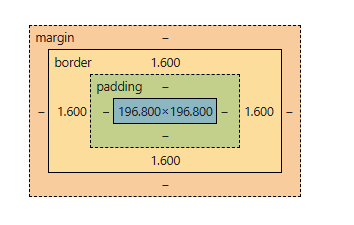

# Buổi 4: Box Model, đơn vị CSS, typography, font và icon

## Mục tiêu

Sau bài này, bạn có thể:

- Tính kích thước với `content-box` và `border-box`.
- Chọn đơn vị CSS và định dạng văn bản dễ đọc.
- Nhúng font, dùng SVG và nhận biết lỗi khoảng cách.

**Kiến thức cần biết trước:** Biết HTML, selector và cách nhúng CSS (buổi 2–3).

## 1. Khái niệm và mục đích

### 1.1. Box Model là gì?

Trong CSS, mọi phần tử HTML đều được coi là một **hình hộp chữ nhật (Box)**. Thuật ngữ **Box Model** (Mô hình hộp) được sử dụng để mô tả cấu trúc của cái hộp này. Nó bao gồm 4 thành phần tính từ trong ra ngoài:

1. **Content (Nội dung):** Vùng chứa nội dung thực tế (chữ, hình ảnh...).
2. **Padding ( Vùng đệm):** Khoảng cách từ Content đến viền (Border). Vùng này trong suốt và có cùng màu nền với Content.
3. **Border (Đường viền):** Đường bao quanh Padding và Content.
4. **Margin (Lề):** Khoảng cách từ Border của phần tử này đến phần tử khác. Vùng này luôn trong suốt.

### 1.2. Đơn vị trong CSS (CSS Units)

CSS cung cấp nhiều đơn vị đo lường để xác định kích thước, khoảng cách. Chúng được chia làm 2 nhóm chính:

- **Đơn vị tuyệt đối (Absolute):** Kích thước cố định, không thay đổi theo môi trường (VD: `px` - pixel).
- **Đơn vị tương đối (Relative):** Kích thước thay đổi dựa trên một yếu tố khác (phần tử cha, kích thước màn hình).
  - `rem`: Tương đối theo font-size của thẻ gốc `<html>` (root).
  - `em`: Với `font-size`, tính theo cỡ chữ kế thừa từ cha; với padding, tính theo cỡ chữ của chính phần tử.
  - `%`: Mốc tham chiếu tùy thuộc tính; `width` theo chiều rộng khối chứa, `font-size` theo cỡ chữ của cha.
  - `vh`, `vw`: Tương đối theo 1% chiều cao (viewport height) hoặc chiều rộng (viewport width) của cửa sổ trình duyệt.

### 1.3. Typography (Nghệ thuật sắp chữ)

Typography trong CSS là tập hợp các thuộc tính dùng để định dạng văn bản sao cho dễ đọc và có tính thẩm mỹ. Các thuộc tính cốt lõi bao gồm:

- `font-family`: Kiểu chữ.
- `font-size`: Kích thước chữ.
- `font-weight`: Độ đậm nhạt (400 là bình thường, 700 là in đậm).
- `line-height`: Khoảng cách giữa các dòng.
- `text-align`: Căn lề văn bản (left, center, right, justify).

### 1.4. Tài nguyên ngoại vi (Fonts & Icons)

- **Fonts:** Sử dụng các dịch vụ như Google Fonts để tải các phông chữ đẹp thay vì chỉ dùng phông chữ mặc định của hệ điều hành.
- **Icons:** Sử dụng thư viện icon (như FontAwesome) hoặc file ảnh Vector (SVG) để hiển thị các biểu tượng (nút search, giỏ hàng...) giúp UI trực quan hơn.

## 2. Cú pháp cơ bản

Phần này trình bày **thuộc tính riêng (longhand) trước, thuộc tính viết tắt (shorthand) sau**. Mỗi ví dụ viết tắt đi kèm cách đọc để bạn biết chính xác cạnh nào đang được thay đổi.

### 2.1. Kích thước của hộp

| Thuộc tính | Công dụng | Ví dụ |
| --- | --- | --- |
| `width` | Đặt chiều rộng | `width: 300px;` |
| `height` | Đặt chiều cao | `height: 200px;` |
| `min-width` | Chiều rộng nhỏ nhất | `min-width: 200px;` |
| `max-width` | Chiều rộng lớn nhất | `max-width: 100%;` |
| `min-height` | Chiều cao nhỏ nhất | `min-height: 120px;` |
| `max-height` | Chiều cao lớn nhất | `max-height: 400px;` |

`width` và `height` tính cho vùng nào phụ thuộc vào `box-sizing` ở mục 2.5. Với khối văn bản thông thường, nên để chiều cao tự tính theo nội dung khi không cần cố định chiều cao.

```css
.card {
  width: 300px;
  max-width: 100%; /* Giới hạn theo chiều rộng khối chứa */
  min-height: 120px; /* Vẫn được cao thêm khi nội dung dài */
}
```

Không có shorthand gộp `width` và `height` thành một khai báo.

### 2.2. Padding: viết riêng từng cạnh

Padding tạo khoảng đệm **giữa nội dung và đường viền**, nằm bên trong hộp.

| Thuộc tính | Vị trí | Ví dụ |
| --- | --- | --- |
| `padding-top` | Đệm trên | `padding-top: 8px;` |
| `padding-right` | Đệm phải | `padding-right: 16px;` |
| `padding-bottom` | Đệm dưới | `padding-bottom: 24px;` |
| `padding-left` | Đệm trái | `padding-left: 32px;` |

```css
.card {
  padding-top: 8px;
  padding-right: 16px;
  padding-bottom: 24px;
  padding-left: 32px;
}
```

Nội dung cách viền trên 8px, phải 16px, dưới 24px và trái 32px. Nền của phần tử thường được vẽ cả trong vùng padding.

**Giá trị:** Padding nhận độ dài như `px`, `rem` hoặc phần trăm; không nhận giá trị âm hoặc `auto`. Trong chế độ viết ngang thông thường, phần trăm padding của cả bốn cạnh tính theo chiều rộng khối chứa.

### 2.3. Margin: viết riêng từng cạnh

Margin tạo khoảng lề **bên ngoài đường viền**, dùng để tạo khoảng cách với phần tử xung quanh.

| Thuộc tính | Vị trí | Ví dụ |
| --- | --- | --- |
| `margin-top` | Lề trên | `margin-top: 8px;` |
| `margin-right` | Lề phải | `margin-right: 16px;` |
| `margin-bottom` | Lề dưới | `margin-bottom: 24px;` |
| `margin-left` | Lề trái | `margin-left: 32px;` |

```css
.card {
  margin-top: 8px;
  margin-right: 16px;
  margin-bottom: 24px;
  margin-left: 32px;
}
```

Khối có lề trên 8px, phải 16px, dưới 24px và trái 32px. Margin trong suốt, không được tô bởi nền của chính phần tử.

**Giá trị:** Margin nhận độ dài, phần trăm, giá trị âm và `auto`. Margin âm có thể làm các phần tử gần hoặc chồng lên nhau. Margin dọc có thể bị gộp trong luồng block thông thường (mục 6.2).

Để căn giữa một phần tử block theo chiều ngang trong luồng thông thường, đặt chiều rộng nhỏ hơn khối chứa rồi dùng hai lề ngang tự động:

```css
.card {
  width: 300px;
  margin-left: auto;
  margin-right: auto;
}
```

Hai lề tự động chia đều khoảng trống ngang còn lại. Cách này không tự căn giữa theo chiều dọc.

### 2.4. Border: viết riêng từng thành phần và từng cạnh

Mỗi cạnh viền gồm **độ dày (width), kiểu nét (style), màu (color)**.

| Cạnh | Độ dày | Kiểu nét | Màu |
| --- | --- | --- | --- |
| Trên | `border-top-width` | `border-top-style` | `border-top-color` |
| Phải | `border-right-width` | `border-right-style` | `border-right-color` |
| Dưới | `border-bottom-width` | `border-bottom-style` | `border-bottom-color` |
| Trái | `border-left-width` | `border-left-style` | `border-left-color` |

```css
.card {
  border-top-width: 1px;
  border-top-style: solid;
  border-top-color: red;

  border-right-width: 2px;
  border-right-style: dashed;
  border-right-color: green;

  border-bottom-width: 3px;
  border-bottom-style: dotted;
  border-bottom-color: blue;

  border-left-width: 4px;
  border-left-style: solid;
  border-left-color: black;
}
```

Kết quả: viền trên đỏ liền nét dày 1px; phải xanh lá đứt nét dày 2px; dưới xanh dương chấm nét dày 3px; trái đen liền nét dày 4px.

- Độ dày: độ dài không âm như `1px`, `0.125rem`, hoặc `thin`, `medium`, `thick`; không nhận phần trăm.
- Kiểu nét: `solid` (liền), `dashed` (đứt), `dotted` (chấm), `double` (kép), `none` (không có viền).
- Màu: tên màu, hex hoặc hàm màu, ví dụ `red`, `#333333`, `rgb(0 0 0 / 50%)`.

> **Lưu ý:** Chỉ đặt độ dày và màu chưa đủ để thấy viền nếu kiểu nét vẫn là `none`. Cần chọn kiểu như `solid`.

### 2.5. Box-sizing: chọn cách tính kích thước

`box-sizing` là thuộc tính riêng, không phải shorthand.

```css
.content-box-example {
  box-sizing: content-box;
}

.border-box-example {
  box-sizing: border-box;
}
```

- `content-box`: `width`, `height` đặt kích thước vùng nội dung; padding và border cộng thêm bên ngoài.
- `border-box`: kích thước khai báo bao gồm nội dung, padding và border.
- Margin nằm ngoài kích thước khai báo trong cả hai cách.

Xem phép tính cụ thể ở mục 3.1.

### 2.6. Shorthand: cách viết tắt

Sau khi hiểu các thuộc tính riêng, bạn có thể gộp lại. Các đoạn code dưới đây là những **cách viết thay thế**, không cần chép tất cả vào cùng một selector.

#### Padding: gộp bốn cạnh

Viết đầy đủ:

```css
.card {
  padding-top: 8px;
  padding-right: 16px;
  padding-bottom: 24px;
  padding-left: 32px;
}
```

Viết tắt tương đương:

```css
.card {
  padding: 8px 16px 24px 32px;
}
```

| Số giá trị | Cú pháp | Cách đọc |
| --- | --- | --- |
| 1 | `padding: 16px;` | Cả bốn cạnh 16px |
| 2 | `padding: 8px 16px;` | Trên/dưới 8px; phải/trái 16px |
| 3 | `padding: 8px 16px 24px;` | Trên 8px; phải/trái 16px; dưới 24px |
| 4 | `padding: 8px 16px 24px 32px;` | Trên 8px; phải 16px; dưới 24px; trái 32px |

Nhớ thứ tự theo chiều kim đồng hồ: **trên → phải → dưới → trái**.

#### Margin: cùng quy tắc một đến bốn giá trị

Bốn khai báo riêng ở mục 2.3 tương đương:

```css
.card {
  margin: 8px 16px 24px 32px;
}
```

| Số giá trị | Cú pháp | Cách đọc |
| --- | --- | --- |
| 1 | `margin: 16px;` | Cả bốn lề 16px |
| 2 | `margin: 8px 16px;` | Trên/dưới 8px; phải/trái 16px |
| 3 | `margin: 8px 16px 24px;` | Trên 8px; phải/trái 16px; dưới 24px |
| 4 | `margin: 8px 16px 24px 32px;` | Trên 8px; phải 16px; dưới 24px; trái 32px |

Ví dụ căn giữa với lề trên và dưới bằng 0:

```css
.card {
  width: 300px;
  margin: 0 auto;
}
```

Tương đương `margin-top: 0`, `margin-right: auto`, `margin-bottom: 0`, `margin-left: auto`.

#### Border: gộp theo từng cạnh

Ba thuộc tính `border-top-width`, `border-top-style`, `border-top-color` có thể gộp thành `border-top`. Tương tự cho ba cạnh còn lại:

```css
.card {
  border-top: 1px solid red;
  border-right: 2px dashed green;
  border-bottom: 3px dotted blue;
  border-left: 4px solid black;
}
```

Đoạn này tương đương 12 khai báo ở mục 2.4. Quy ước dễ đọc là **độ dày → kiểu nét → màu**.

#### Border: gộp theo độ dày, kiểu hoặc màu

Một cách khác để viết cùng ví dụ:

```css
.card {
  border-width: 1px 2px 3px 4px;
  border-style: solid dashed dotted solid;
  border-color: red green blue black;
}
```

`border-width`, `border-style`, `border-color` nhận từ một đến bốn giá trị theo quy tắc phân bố cạnh giống `padding` và `margin`.

#### Border: gộp cả bốn cạnh giống nhau

Nếu cả bốn cạnh cùng độ dày, kiểu và màu:

```css
.card {
  border: 2px solid #333333;
}
```

Tương đương:

```css
.card {
  border-width: 2px;
  border-style: solid;
  border-color: #333333;
}
```

> **Lưu ý:** `border: 1px 2px 3px 4px` không phải cách đặt bốn độ dày. Hãy dùng `border-width`.

#### Kết hợp longhand và shorthand: chú ý thứ tự

Shorthand thiết lập các thuộc tính con của nó. Với các khai báo cùng mức ưu tiên trong cùng quy tắc, khai báo sau quyết định giá trị bị trùng:

```css
.card {
  padding: 16px;
  padding-left: 32px; /* Trái 32px; ba cạnh còn lại 16px */
}

.other-card {
  padding-left: 32px;
  padding: 16px; /* Cả bốn cạnh trở về 16px */
}
```

Với `border`, thành phần bị bỏ qua trong shorthand trở về giá trị khởi tạo, không giữ giá trị đã khai báo trước đó:

```css
.card {
  border: 2px solid red;
  border: 1px; /* Style trở về none nên không thấy viền */
}
```

Muốn chỉ thay đổi một phần, dùng thuộc tính riêng như `padding-top`, `margin-bottom` hoặc `border-left-color`.

### 2.7. Định dạng chữ và ví dụ kết hợp

Các thuộc tính chữ viết riêng để dễ theo dõi:

```css
.card {
  font-family: Arial, sans-serif; /* Font ưu tiên và dự phòng */
  font-size: 1rem; /* Cỡ chữ theo phần tử gốc */
  font-weight: 400; /* Độ đậm bình thường */
  line-height: 1.6; /* Chiều cao dòng bằng 1,6 lần cỡ chữ */
  text-align: left; /* Căn chữ về trái */
}
```

Kết hợp các thuộc tính Box Model đã học:

```css
.card {
  box-sizing: border-box;
  width: 300px;
  max-width: 100%;
  padding: 16px 24px;
  border: 2px solid #333333;
  margin: 24px auto;
  font-family: Arial, sans-serif;
  font-size: 1rem;
  line-height: 1.6;
}
```

Khi đủ chỗ, hộp rộng 300px tính cả padding và border; padding trên/dưới 16px, phải/trái 24px; viền đều 2px. Lề trên/dưới 24px và hai lề ngang tự động để căn giữa trong luồng block thông thường.

## 3. Cách hoạt động

### 3.1. Cơ chế tính toán kích thước Box Model

Mặc định, thuộc tính `width` và `height` trong CSS **chỉ áp dụng cho vùng Content**. Điều này dẫn đến cơ chế cộng dồn kích thước rất dễ gây vỡ Layout.



*Nguồn ảnh: [GeeksforGeeks](https://media.geeksforgeeks.org/wp-content/uploads/20241210112354236207/Screenshot-2024-12-10-105714.png).*

**Bài toán:** Bạn có 1 thẻ `<div>` thiết lập `width: 300px`, `padding: 20px`, `border: 5px solid black`.

- **Cơ chế mặc định (`box-sizing: content-box`):**
  Tổng chiều rộng thực tế = Width (300) + Padding Left (20) + Padding Right (20) + Border Left (5) + Border Right (5) = **350px**. (Khối bị phình to ra so với dự tính 300px ban đầu).
- **Cơ chế hiện đại (`box-sizing: border-box`):**
  Trình duyệt sẽ tự động ép Padding và Border lùi vào bên trong. Tổng chiều rộng thực tế vẫn được giữ nguyên là **300px**. (Content sẽ tự động nhỏ lại còn 250px).

### 3.2. Cơ chế hoạt động của `rem`

Cỡ chữ gốc thường là `16px` nếu người dùng và stylesheet chưa thay đổi.

- Nếu bạn set `font-size: 2rem` -> Kích thước thực tế = 2 \* 16px = `32px`.
- Nếu stylesheet giữ cỡ chữ gốc theo mặc định trình duyệt, tăng mặc định từ `16px` lên `20px` sẽ khiến `2rem` tăng từ `32px` lên `40px`. Cố định cỡ chữ gốc bằng `px` làm mất sự phụ thuộc này. Zoom trang vẫn phóng to cả chữ dùng `px`.

## 4. Ví dụ minh họa

### Yêu cầu

Tạo thẻ rộng tối đa 300px, có padding và viền nhưng không vượt chiều rộng đã đặt.

### Code

Lưu thành `index.html`:

```html
<!DOCTYPE html>
<html lang="vi">
<head>
  <meta charset="UTF-8">
  <meta name="viewport" content="width=device-width, initial-scale=1.0">
  <title>Thẻ giới thiệu</title>
  <style>
    *, *::before, *::after { box-sizing: border-box; }
    body { margin: 0; font-family: Arial, sans-serif; line-height: 1.6; }
    .card {
      width: 300px;
      max-width: 100%;
      padding: 20px;
      border: 5px solid black;
      margin: 24px auto;
    }
    .card__title { margin: 0 0 16px; font-size: 1.5rem; }
    .card__desc { margin: 0; font-size: 1rem; }
  </style>
</head>
<body>
  <article class="card">
    <h1 class="card__title">Nguyễn An</h1>
    <p class="card__desc">Thành viên lớp Web HIT.</p>
  </article>
</body>
</html>
```

### Giải thích và kết quả

Khi đủ chỗ, chiều rộng gồm content, padding và border là 300px. Vùng content rộng `300 − 2 × 20 − 2 × 5 = 250px`; margin nằm ngoài. Khi vùng chứa hẹp hơn, `max-width: 100%` giới hạn thẻ. Nếu cỡ chữ gốc là 16px, tiêu đề `1.5rem` tương ứng 24px.

## 5. Các trường hợp thường dùng

### 5.1. Thiết lập Box Model dùng chung

Luôn luôn bắt đầu file CSS của bạn với đoạn code Reset CSS này để thống nhất cơ chế `border-box` cho mọi phần tử.

```css
/* style.css */
*,
*::before,
*::after {
  box-sizing: border-box;
  margin: 0;
  padding: 0;
}

html {
  /* Theo cỡ chữ người dùng chọn; thường 1rem = 16px */
  font-size: 100%;
}
```

### 5.2. Nhúng Google Fonts

Truy cập Google Fonts, chọn phông chữ (VD: Roboto) và nhúng vào file HTML.

```html
<!-- index.html (Bên trong thẻ <head>) -->
<link rel="preconnect" href="https://fonts.googleapis.com" />
<link rel="preconnect" href="https://fonts.gstatic.com" crossorigin />
<link
  href="https://fonts.googleapis.com/css2?family=Roboto:wght@400;700&display=swap"
  rel="stylesheet"
/>
```

Sau đó áp dụng trong CSS:

```css
body {
  font-family: "Roboto", sans-serif; /* Sử dụng font Roboto */
  line-height: 1.6; /* Chiều cao dòng chuẩn để dễ đọc */
  color: #333333; /* Màu chữ không nên đen xì (#000) */
}
```

### 5.3. Sử dụng đơn vị tương đối và typography

Thay vì dùng `px`, hãy tập thói quen dùng `rem` cho kích thước chữ và khoảng cách.

```css
.card {
  width: 100%;
  max-width: 25rem; /* ~400px */
  padding: 1.5rem; /* ~24px */
  border: 1px solid #ddd;
  border-radius: 0.5rem; /* ~8px */
  margin: 2rem auto; /* Căn giữa */
}

.card__title {
  font-size: 1.5rem; /* ~24px */
  font-weight: 700;
  text-transform: uppercase; /* In hoa toàn bộ */
  margin-bottom: 1rem;
}

.card__desc {
  font-size: 1rem; /* ~16px */
  color: #666;
}
```

### 5.4. Nhúng và sử dụng icon SVG

Trong các dự án hiện đại (đặc biệt khi code ReactJS sau này), sử dụng trực tiếp mã `<svg>` được ưu tiên hơn vì không phải tải thêm toàn bộ thư viện font icon cồng kềnh.

```html
<button class="btn-download">
  <!-- Mã SVG của một chiếc icon tải xuống -->
  <svg
    width="24"
    height="24"
    viewBox="0 0 24 24"
    fill="none"
    stroke="currentColor"
    stroke-width="2"
    stroke-linecap="round"
    stroke-linejoin="round"
  >
    <path d="M21 15v4a2 2 0 0 1-2 2H5a2 2 0 0 1-2-2v-4"></path>
    <polyline points="7 10 12 15 17 10"></polyline>
    <line x1="12" y1="15" x2="12" y2="3"></line>
  </svg>
  Tải về ngay
</button>
```

```css
.btn-download {
  display: inline-flex; /* Đưa icon và chữ nằm ngang */
  align-items: center; /* Căn giữa theo chiều dọc */
  gap: 0.5rem; /* Khoảng cách giữa icon và chữ */
  padding: 0.75rem 1.25rem;
  font-size: 1rem;
  cursor: pointer;
}
```

### 5.5. Lựa chọn SVG và font icon

Trong quá khứ, FontAwesome (dùng thẻ `<i class="fas fa-home"></i>`) rất thịnh hành. Tuy nhiên, ở các dự án React/TS hiện đại, lập trình viên ưa chuộng **Inline SVG** (sử dụng thư viện như `lucide-react` hoặc `react-icons`) bởi vì:

- **Tối ưu hiệu năng:** Ứng dụng chỉ tải đúng những icon được dùng (Tree-shaking), thay vì tải cả bộ font hàng ngàn icon.
- **Tùy biến dễ dàng:** Có thể đổi màu SVG trực tiếp bằng thuộc tính CSS `color` hoặc `fill` kế thừa từ text.
- **Không bị chớp nháy (FOIT):** SVG render cùng lúc với HTML, không bị delay như việc chờ tải file font từ server.

### 5.6. Tối ưu tải font (Font Display)

Khi nhúng Google Fonts, luôn đảm bảo URL có tham số `&display=swap`. Điều này báo cho trình duyệt: _Hãy hiển thị chữ bằng font mặc định trước, khi nào tải xong font Google thì mới tráo đổi (swap) sang._ Giúp người dùng không phải nhìn thấy "màn hình trống rỗng" lúc mạng chậm.

### 5.7. Fluid Typography (Chữ tự động co giãn)

Sử dụng hàm `clamp()` của CSS hiện đại để chữ tự to nhỏ theo màn hình mà không cần viết quá nhiều Media Queries:

```css
/* Cú pháp: clamp(nhỏ nhất, lý tưởng, lớn nhất) */
h1 {
  font-size: clamp(1.5rem, 5vw, 3rem);
}
```

_Giải thích:_ Font size sẽ thay đổi theo 5% chiều rộng màn hình, nhưng không bao giờ nhỏ hơn `1.5rem` và không lớn quá `3rem`.

## 6. Lỗi thường gặp và lưu ý

### 6.1. Vỡ giao diện do quên thiết lập `border-box`

Đây là lỗi kinh điển nhất của người mới học. Set khối rộng 50%, sau đó thêm `padding`, kết quả khối chiếm hơn 50% màn hình và đẩy khối khác rớt dòng.

❌ **Nguyên nhân:** Dùng `box-sizing` mặc định (content-box).
✅ **Khắc phục:** Luôn khai báo đoạn code Reset CSS bằng thẻ `*` (đã cung cấp ở mục 5.1).

### 6.2. Margin Collapse (Sụp lún Margin)

Trong luồng block thông thường, khi các margin dọc liền kề đủ điều kiện gộp và đều không âm, nếu khối trên có `margin-bottom: 30px` và khối dưới có `margin-top: 20px`, khoảng cách thực tế giữa chúng **không phải là 50px**, mà bị gộp lại lấy giá trị lớn hơn (là **30px**).

❌ **Hiểu sai:** Nghĩ rằng margin sẽ cộng dồn.
✅ **Khắc phục:** Nên thống nhất chỉ dùng margin một chiều (ví dụ: luôn dùng `margin-bottom` để tạo khoảng cách giữa các phần tử) để tránh nhầm lẫn.

### 6.3. Cỡ chữ không theo thiết lập mặc định của người dùng

**Biểu hiện:** Chữ dùng `px` không đổi theo cỡ chữ mặc định trình duyệt.

**Nguyên nhân:** Kích thước cố định không phụ thuộc cỡ chữ gốc. Zoom trang vẫn phóng to chữ dùng `px`.

**Cách sửa:** Dùng `rem` và giữ cỡ chữ gốc theo thiết lập trình duyệt.

**Kích thước cố định:** `.text { font-size: 14px; }`
**Theo cỡ chữ gốc:** `.text { font-size: 0.875rem; }` (Tính bằng 14 / 16 = 0.875).

## 7. Tóm tắt

- Box Model gồm content, padding, border và margin.
- `border-box` tính padding và border trong kích thước khai báo; margin ở ngoài.
- `rem` dựa vào cỡ chữ gốc; chọn đơn vị theo đại lượng cần đo.
- Khai báo font dự phòng và kiểm tra khi font ngoài chưa tải.

## 8. Bài tập thực hành

1. Tạo thẻ giới thiệu với tiêu đề, mô tả và nút có SVG.
2. Đặt `width: 320px`, `padding: 24px`, `border: 2px solid`; so sánh `content-box` và `border-box`.
3. Dùng `rem` cho cỡ chữ và `line-height` không đơn vị.
4. Giữ cỡ chữ gốc theo mặc định trình duyệt, sau đó tăng mặc định và quan sát.

**Tiêu chí hoàn thành:** Khi đủ chỗ, `border-box` tạo chiều rộng ngoài viền 320px, vùng content 268px; giải thích được cách tính và chữ vẫn dễ đọc khi tăng cỡ mặc định.

## Tài liệu tham khảo

- [MDN: Box Model](https://developer.mozilla.org/en-US/docs/Learn_web_development/Core/Styling_basics/Box_model)
- [MDN: Đơn vị độ dài CSS](https://developer.mozilla.org/en-US/docs/Web/CSS/length)
- [Google Fonts](https://fonts.google.com/)
