# [Buổi 5: Flexbox, Grid và Responsive Design](https://thienbao28287.github.io/WEB_PRIVATE_2026/#/Lesson5/theory?section=buoi-5-flexbox-grid-va-responsive-design)

## 1. Flexbox

### 1.1. Khái niệm

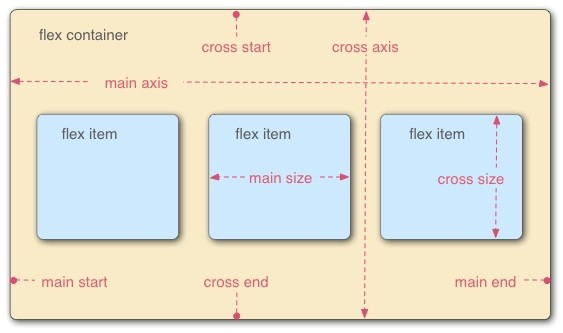

\- Flexbox (viết tắt của Flexible Box Layout) là mô hình bố cục một chiều trong CSS, giúp sắp xếp, căn chỉnh và phân phối không gian giữa các phần tử bên trong một vùng chứa một cách linh hoạt, ngay cả khi kích thước của chúng chưa biết trước hoặc thay đổi.

\- Phần tử cha được gọi là **Flex Container**. Các phần tử con trực tiếp bên trong được gọi là **Flex Items**.

\- **Main Axis** là trục chính mà các phần tử con xếp theo. **Cross Axis** là trục phụ, vuông góc với trục chính.

### 1.2. Thuộc tính cho Flex Container (phần tử cha)

\- Để kích hoạt Flexbox, đặt `display: flex;` hoặc `display: inline-flex;` cho phần tử cha. Các hướng dưới đây xét theo cách viết thông thường từ trái sang phải, từ trên xuống dưới.

#### 1.2.1. `display` — Kích hoạt Flexbox

\- Kích hoạt môi trường Flexbox. Hai giá trị thường dùng là `flex` và `inline-flex`.

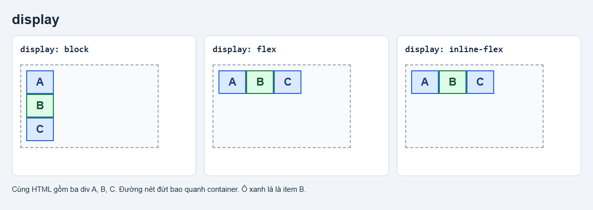

#### 1.2.2. `flex-direction` — Hướng sắp xếp

\- Xác định hướng của trục chính mà các phần tử con xếp theo.

- `row` (mặc định) xếp ngang từ trái sang phải.
- `row-reverse` xếp ngang từ phải sang trái.
- `column` xếp dọc từ trên xuống dưới.
- `column-reverse` xếp dọc từ dưới lên trên.


#### 1.2.3. `flex-wrap` — Xuống dòng

\- Quy định các phần tử con có tạo dòng mới khi thiếu không gian hay không.

- `nowrap` (mặc định) giữ các phần tử trên một dòng flex. Chúng có thể co lại hoặc tràn khi thiếu chỗ.
- `wrap` cho phép tạo dòng mới. Với `row`, các hàng mới nằm phía dưới.
- `wrap-reverse` cho phép tạo dòng mới về phía ngược lại. Với `row`, các hàng mới nằm phía trên.


#### 1.2.4. `justify-content` — Căn theo trục chính

\- Căn chỉnh và phân bố các phần tử con theo trục chính. Với `row`, thuộc tính này căn theo chiều ngang. Với `column`, thuộc tính này căn theo chiều dọc.

- `flex-start` dồn các phần tử về đầu trục, là cách căn mặc định thông thường.
- `flex-end` dồn các phần tử về cuối trục.
- `center` căn giữa nhóm phần tử.
- `space-between` đặt phần tử đầu và cuối sát hai mép, chia đều khoảng trống giữa các phần tử.
- `space-around` tạo khoảng trống hai bên mỗi phần tử. Khoảng giữa hai phần tử gấp đôi khoảng ở mép ngoài.
- `space-evenly` tạo khoảng trống bằng nhau giữa các phần tử và ở hai mép ngoài.

\- Cần có không gian còn lại theo trục chính để thấy rõ hiệu ứng phân bố.


#### 1.2.5. `align-items` — Căn theo trục phụ

\- Căn các phần tử con theo trục phụ trong từng dòng flex. Với `row`, thuộc tính này căn theo chiều dọc. Với `column`, thuộc tính này căn theo chiều ngang.

- `stretch` là hành vi mặc định thông thường, kéo giãn phần tử theo trục phụ nếu kích thước theo trục đó là `auto`.
- `flex-start` căn về đầu trục phụ, thường là phía trên với `row` hoặc bên trái với `column`.
- `flex-end` căn về cuối trục phụ, thường là phía dưới với `row` hoặc bên phải với `column`.
- `center` căn giữa theo trục phụ.
- `baseline` căn các phần tử theo đường chân chữ của nội dung bên trong.

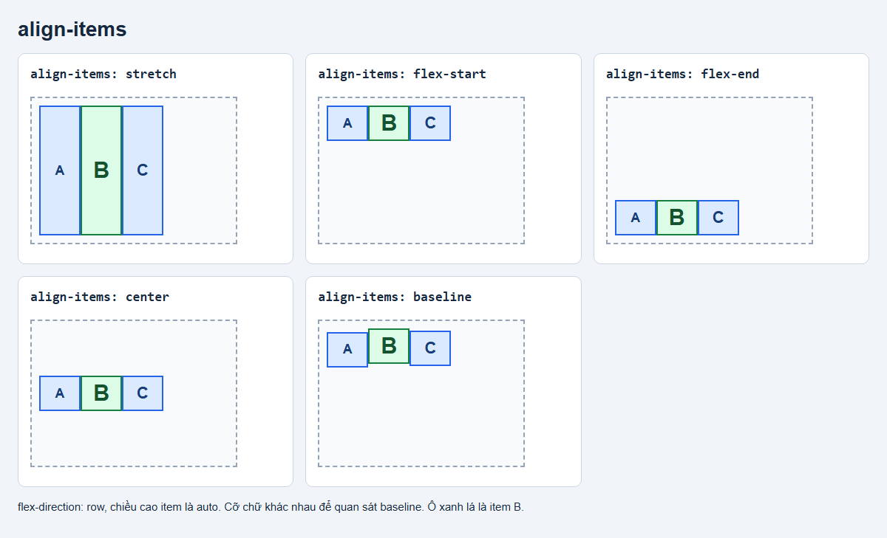

#### 1.2.6. `gap`, `row-gap`, `column-gap` — Khoảng cách

\- Tạo khoảng cách giữa các phần tử và các dòng flex.

- `gap: 16px;` đặt khoảng cách hàng và cột cùng bằng `16px`.
- `gap: 10px 20px;` đặt `row-gap` bằng `10px` và `column-gap` bằng `20px`.
- Với `row`, ví dụ trên tạo khoảng cách giữa các hàng là `10px`, giữa các phần tử trong hàng là `20px`.
- Với `column`, khoảng cách giữa các phần tử trong cột là `10px`, giữa các cột là `20px`.

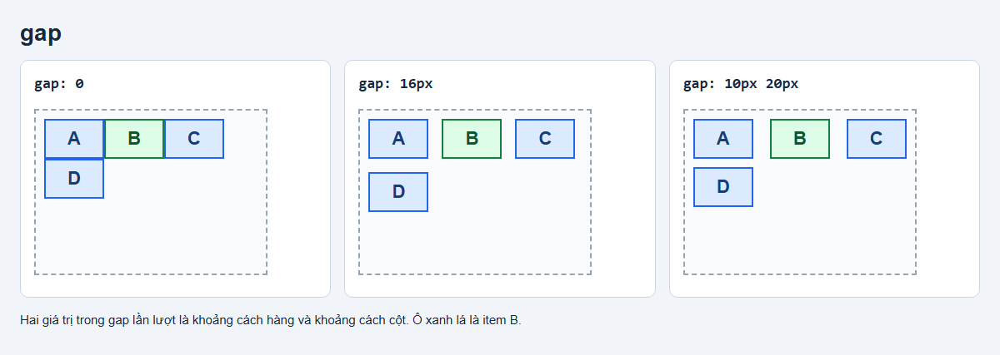

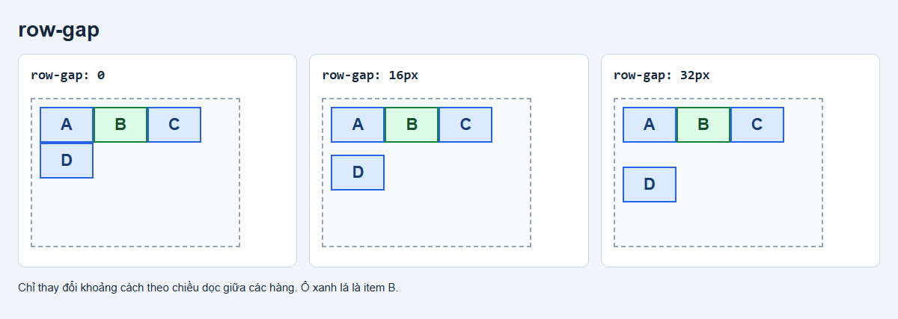


### 1.3. Thuộc tính cho Flex Items (phần tử con)

\- Các thuộc tính dưới đây áp dụng trực tiếp lên từng flex item.

#### 1.3.1. `flex-grow` — Giãn rộng

\- Xác định hệ số nhận thêm không gian khi phần tử cha còn chỗ trống. Mặc định là `0`, phần tử không nhận thêm không gian dư. Item có grow bằng `2` nhận phần không gian dư gấp đôi item có grow bằng `1`, nếu các giới hạn kích thước cho phép.


#### 1.3.2. `flex-shrink` — Co lại

\- Xác định hệ số co lại khi phần tử cha thiếu không gian. Mặc định là `1`. Mức co thực tế phụ thuộc cả hệ số này và kích thước cơ sở của phần tử. Giá trị `0` giữ phần tử khỏi co theo cơ chế shrink.

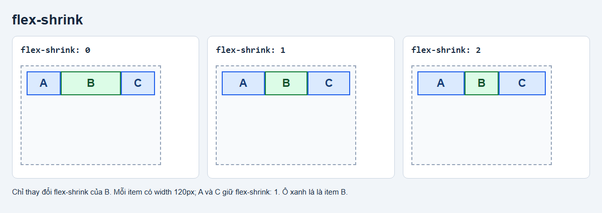

#### 1.3.3. `flex-basis` — Kích thước cơ sở

\- Thiết lập kích thước cơ sở theo trục chính trước khi phân chia không gian. Với `row`, kích thước này theo chiều ngang. Với `column`, kích thước này theo chiều dọc. Mặc định là `auto`.

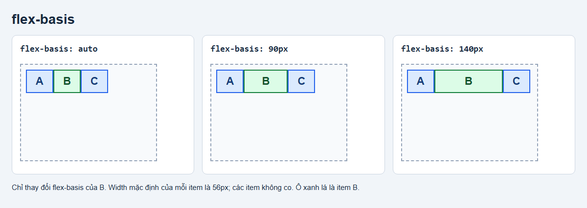

#### 1.3.4. `flex` — Viết gộp grow, shrink và basis

\- Viết gộp ba thuộc tính theo thứ tự `flex-grow flex-shrink flex-basis`. Ví dụ `flex: 1 1 200px;` đặt basis `200px`, cho phép giãn và co với hệ số `1`.

\- `flex: 1;` được trình duyệt mở rộng thành `1 1 0%`. Khi các item cùng dùng giá trị này và có điều kiện padding, border, min/max-size tương đương, chúng thường chia đều không gian theo trục chính.

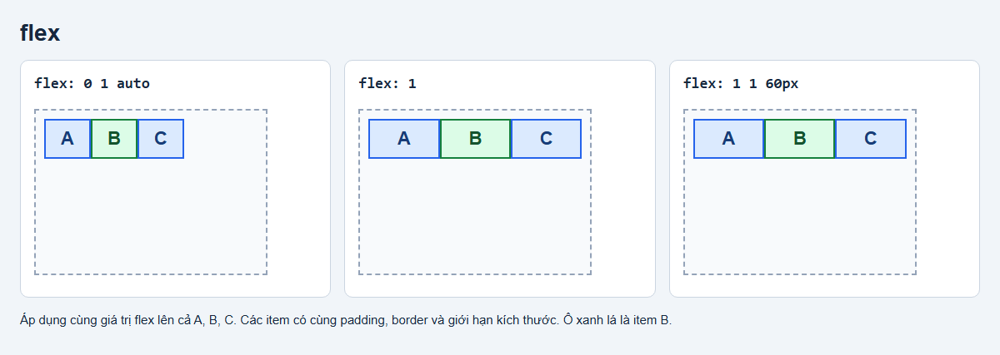

#### 1.3.5. `align-self` — Căn riêng từng item

\- Cho phép một phần tử căn riêng theo trục phụ, ghi đè cách căn từ `align-items` của cha. Các giá trị thường dùng gồm `auto`, `flex-start`, `flex-end`, `center`, `baseline` và `stretch`. Mặc định `auto` dùng cách căn của cha.

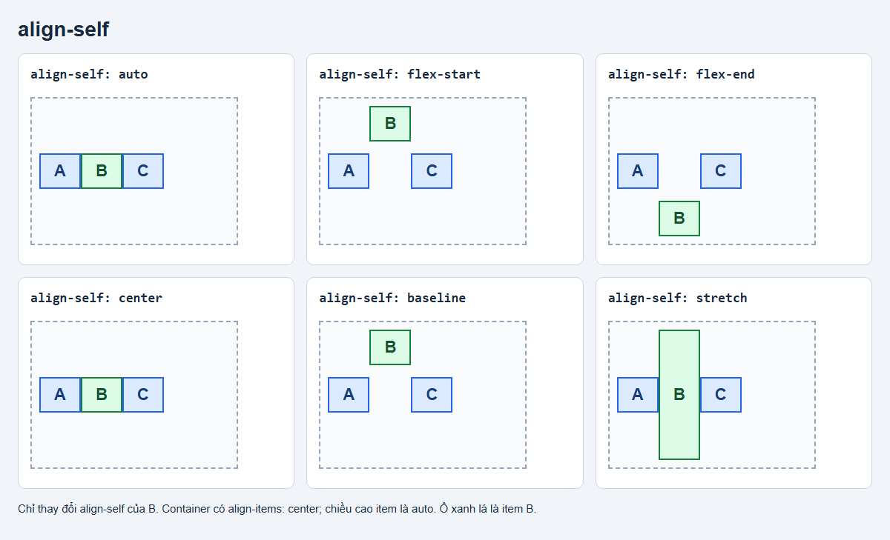

#### 1.3.6. `order` — Thứ tự hiển thị

\- Thay đổi thứ tự hiển thị của phần tử con. Mặc định là `0`, số nhỏ hơn được xếp trước. Nếu cùng giá trị, các phần tử giữ thứ tự trong HTML. Khi sử dụng, cần giữ thứ tự nội dung HTML hợp lý cho việc đọc và di chuyển bằng bàn phím.


## 2. Grid

### 2.1. Khái niệm

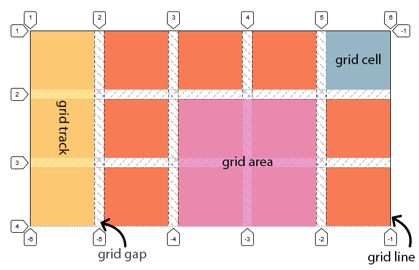

\- CSS Grid là mô hình bố cục hai chiều, giúp sắp xếp phần tử theo cả hàng và cột. Grid phù hợp với danh sách sản phẩm, thư viện ảnh và bố cục gồm nhiều vùng nội dung.

\- **Grid Container** là phần tử cha được khai báo `display: grid` hoặc `display: inline-grid`. Các phần tử con trực tiếp thường trở thành **Grid Items**.

\- **Grid Lines** là các đường phân chia hàng và cột. Ba cột có bốn đường kẻ dọc. **Grid Cell** là một ô, còn **Grid Area** là một vùng hình chữ nhật gồm một hoặc nhiều ô.

### 2.2. Thuộc tính cho Grid Container (phần tử cha)

\- Các cách căn ngang và dọc dưới đây xét theo cách viết tiếng Việt thông thường. Các ảnh giữ cùng cấu trúc HTML, chỉ thay đổi thuộc tính được ghi trong từng ô demo.

#### 2.2.1. `display` — Kích hoạt Grid

\- Đặt thuộc tính trên phần tử cha để kích hoạt bố cục lưới.

- `grid` tạo container tham gia luồng ngoài như một khối.
- `inline-grid` tạo container tham gia luồng ngoài như phần tử inline.

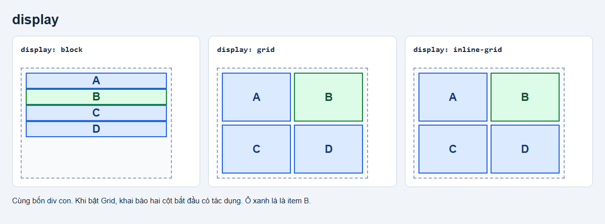

#### 2.2.2. `grid-template-columns` — Khai báo các cột

\- Xác định số cột và chiều rộng từng cột trong lưới.

- `200px 1fr 2fr` tạo ba cột. Cột đầu rộng `200px`, hai cột sau chia không gian còn lại theo tỷ lệ 1:2, có xét giới hạn kích thước nội dung.
- `repeat(3, 1fr)` tạo ba cột linh hoạt bằng nhau khi các giới hạn nội dung cho phép.
- `1fr 2fr` tạo hai cột linh hoạt theo tỷ lệ 1:2.

\- Ví dụ `grid-template-columns: 200px 1fr 2fr;`. Khi cần cột co nhỏ theo khung chứa, có thể dùng `repeat(3, minmax(0, 1fr))` kết hợp cách ngắt dòng phù hợp cho nội dung.

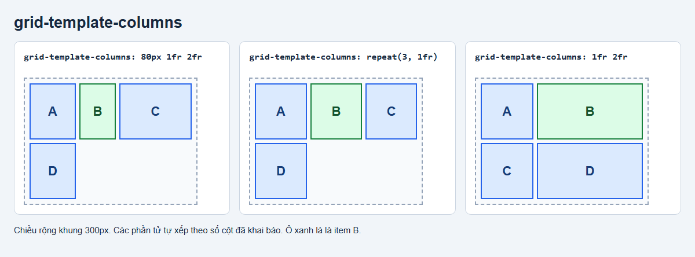

#### 2.2.3. `grid-template-rows` — Khai báo các hàng

\- Xác định số hàng và chiều cao từng hàng. Cách khai báo tương tự các cột.

- `60px 100px` tạo hai hàng cao lần lượt `60px` và `100px`.
- `repeat(2, 80px)` tạo hai hàng, mỗi hàng cao `80px`.
- `auto 1fr` cho hàng đầu cao theo nội dung, hàng sau nhận không gian còn lại khi container có chiều cao xác định.

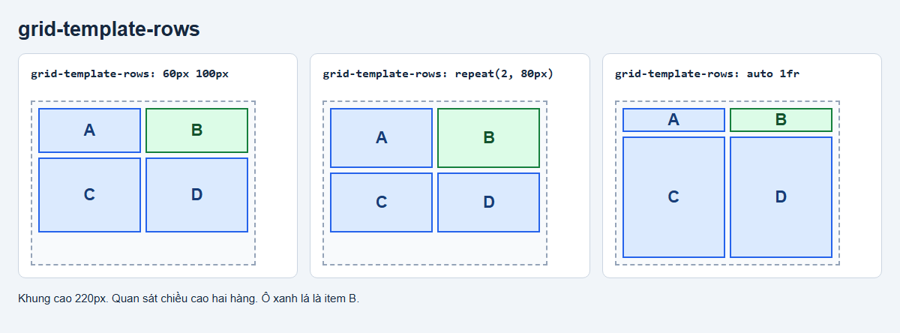

#### 2.2.4. `gap`, `row-gap`, `column-gap` — Khoảng cách

\- Tạo rãnh giữa các hàng và cột. Khoảng cách này được tính khi Grid phân chia không gian, nên có thể làm tăng phần không gian cần dùng hoặc giảm chỗ dành cho các cột linh hoạt.

- `gap: 16px;` đặt khoảng cách hàng và cột cùng bằng `16px`.
- `gap: 10px 20px;` đặt khoảng cách hàng là `10px`, khoảng cách cột là `20px`.
- `row-gap: 10px;` chỉ đặt khoảng cách dọc giữa các hàng.
- `column-gap: 20px;` chỉ đặt khoảng cách ngang giữa các cột.

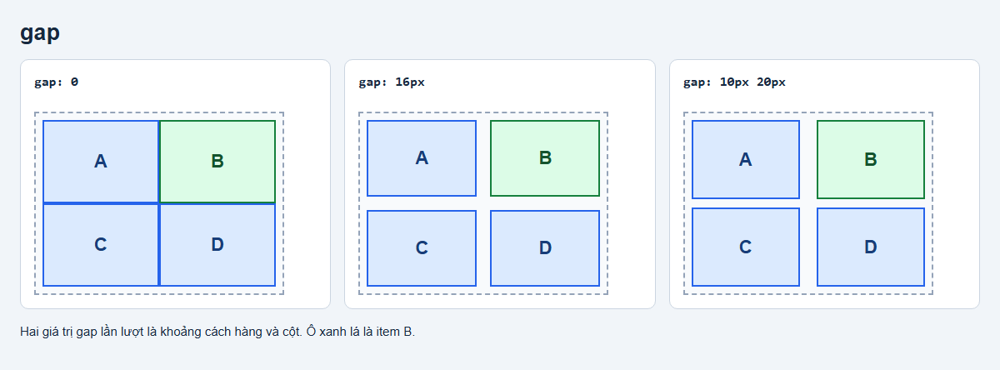

#### 2.2.5. `grid-auto-rows` — Kích thước hàng tự sinh

\- Quy định chiều cao các hàng phát sinh ngoài những hàng đã khai báo bằng `grid-template-rows`.

- `auto` để kích thước phụ thuộc nội dung và cơ chế căn chỉnh của lưới.
- `50px` đặt mỗi hàng tự sinh cao `50px`.
- `minmax(70px, auto)` cho hàng cao ít nhất `70px` và mở rộng theo nội dung.

\- Trong ảnh, chỉ hàng đầu được khai báo bằng `grid-template-rows: 50px;`. Các hàng tiếp theo dùng `grid-auto-rows`.

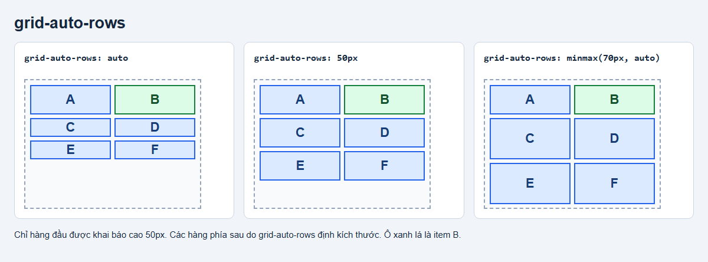

#### 2.2.6. `grid-auto-columns` — Kích thước cột tự sinh

\- Quy định chiều rộng các cột phát sinh ngoài những cột đã khai báo bằng `grid-template-columns`.

- `auto` để kích thước phụ thuộc nội dung và cách phân bố không gian.
- `50px` đặt mỗi cột tự sinh rộng `50px`.
- `100px` đặt mỗi cột tự sinh rộng `100px`.

\- Ảnh dùng `grid-auto-flow: column` để tự xếp theo cột, với hai hàng và một cột ban đầu. Nhờ đó các cột bổ sung được tạo để quan sát.

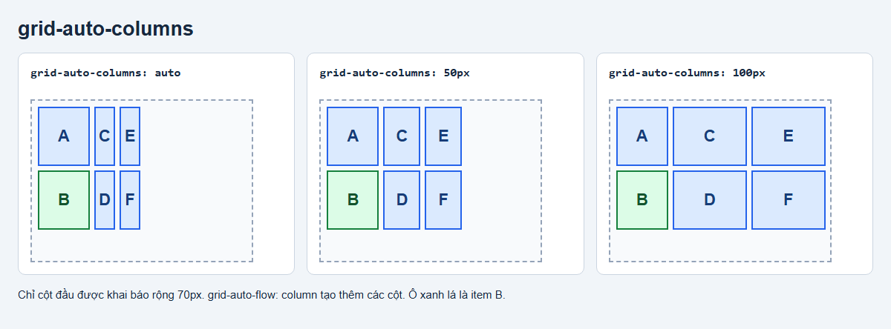

#### 2.2.7. `justify-items` — Căn item theo chiều ngang

\- Căn từng item theo chiều ngang bên trong vùng lưới được cấp cho nó.

- `start` căn về bên trái.
- `end` căn về bên phải.
- `center` căn giữa theo chiều ngang.
- `stretch` kéo giãn chiều rộng item nếu kích thước và các giới hạn cho phép.

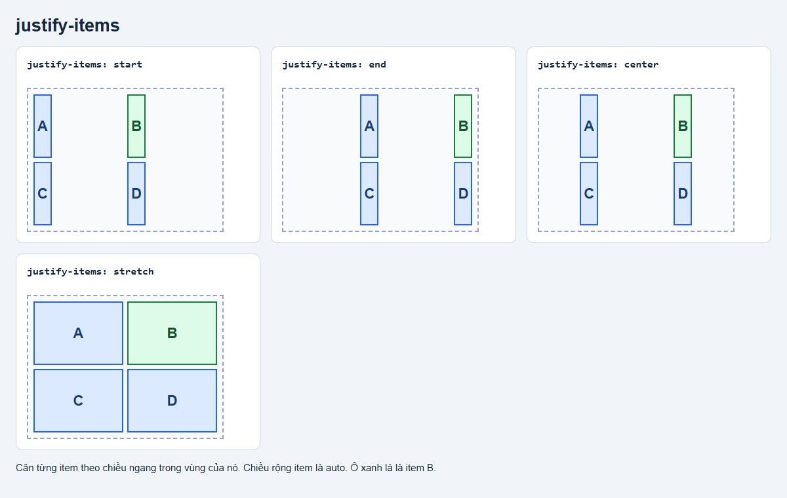

#### 2.2.8. `align-items` — Căn item theo chiều dọc

\- Căn từng item theo chiều dọc bên trong vùng lưới được cấp cho nó.

- `start` căn lên phía trên.
- `end` căn xuống phía dưới.
- `center` căn giữa theo chiều dọc.
- `stretch` kéo giãn chiều cao item nếu kích thước và các giới hạn cho phép.

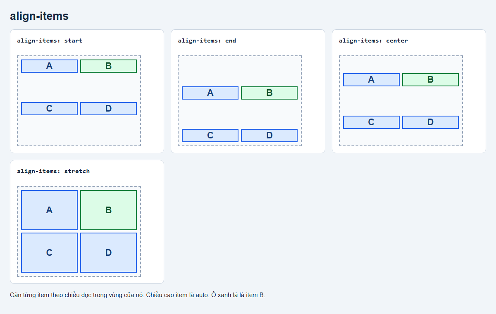

#### 2.2.9. `place-items` — Căn theo cả hai chiều

\- Viết gộp `align-items` và `justify-items`, theo đúng thứ tự đó. Một giá trị được áp dụng cho cả hai thuộc tính.

- `place-items: start;` căn item lên trên và sang trái.
- `place-items: center;` căn giữa theo cả hai chiều.
- `place-items: end;` căn item xuống dưới và sang phải.
- `place-items: center stretch;` căn giữa theo chiều dọc, kéo giãn theo chiều ngang khi có thể.

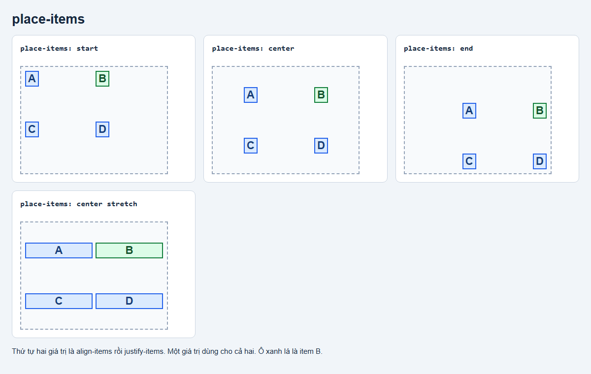

### 2.3. Thuộc tính cho Grid Items (phần tử con)

\- Các thuộc tính dưới đây áp dụng lên từng grid item để chọn vị trí, chiếm nhiều ô hoặc căn riêng trong vùng được cấp.

#### 2.3.1. `grid-column` — Vị trí và số cột chiếm dụng

\- Chỉ định đường kẻ dọc bắt đầu và kết thúc, hoặc số cột item cần chiếm.

- `auto` để Grid tự đặt vị trí.
- `1 / 3` chiếm vùng từ đường cột 1 đến đường cột 3, tức hai cột.
- `span 2` yêu cầu chiếm hai cột. Khi chưa khai báo đường bắt đầu, vị trí được cơ chế tự xếp xác định.

\- Ví dụ `grid-column: 1 / 3;`. Các số chỉ đường kẻ, không phải số ô.

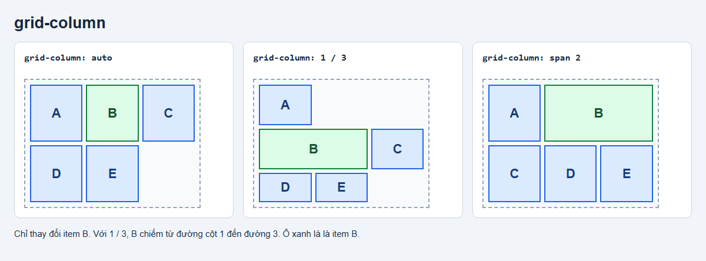

#### 2.3.2. `grid-row` — Vị trí và số hàng chiếm dụng

\- Chỉ định đường kẻ ngang bắt đầu và kết thúc, hoặc số hàng item cần chiếm.

- `auto` để Grid tự đặt vị trí.
- `1 / 3` chiếm hai hàng giữa đường hàng 1 và đường hàng 3.
- `span 2` yêu cầu chiếm hai hàng.

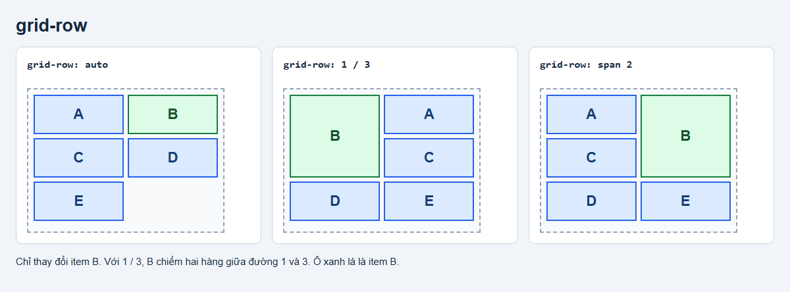

#### 2.3.3. `grid-area` — Đặt vị trí hoặc gán vùng

\- Viết gộp bốn giá trị theo thứ tự `row-start / column-start / row-end / column-end`, hoặc gán item vào vùng được đặt tên ở container.

- `auto` để Grid tự xác định vị trí.
- `1 / 1 / 3 / 3` chiếm từ đường hàng 1 đến 3 và đường cột 1 đến 3, tạo vùng hai hàng, hai cột.
- `main` gán item vào vùng tên `main` đã khai báo bằng `grid-template-areas`.

```css
.layout {
    display: grid;
    grid-template-columns: repeat(3, minmax(0, 1fr));
    grid-template-areas:
        "main main side"
        "main main side"
        "bottom bottom bottom";
}

.layout__main {
    grid-area: main;
}
```

\- Mỗi hàng khai báo phải có cùng số ô. Các ô cùng tên phải tạo thành một vùng hình chữ nhật.

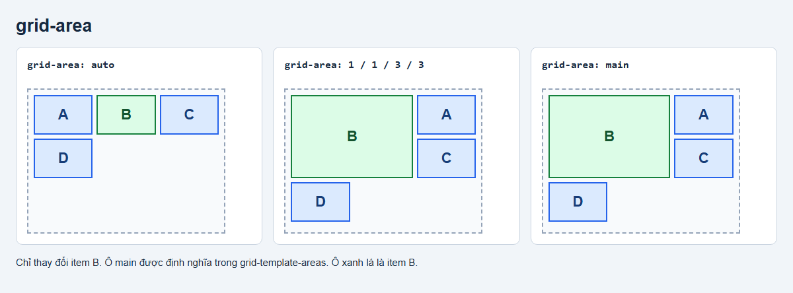

#### 2.3.4. `justify-self` — Căn riêng theo chiều ngang

\- Ghi đè cách căn từ `justify-items` của cha cho một item.

- `start` căn trái.
- `end` căn phải.
- `center` căn giữa theo chiều ngang.
- `stretch` kéo giãn chiều rộng khi có thể.

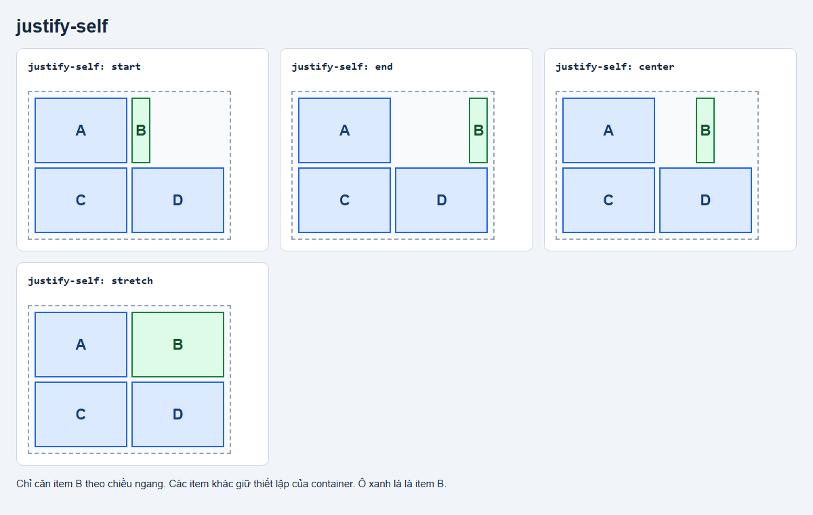

#### 2.3.5. `align-self` — Căn riêng theo chiều dọc

\- Ghi đè cách căn từ `align-items` của cha cho một item.

- `start` căn lên trên.
- `end` căn xuống dưới.
- `center` căn giữa theo chiều dọc.
- `stretch` kéo giãn chiều cao khi có thể.

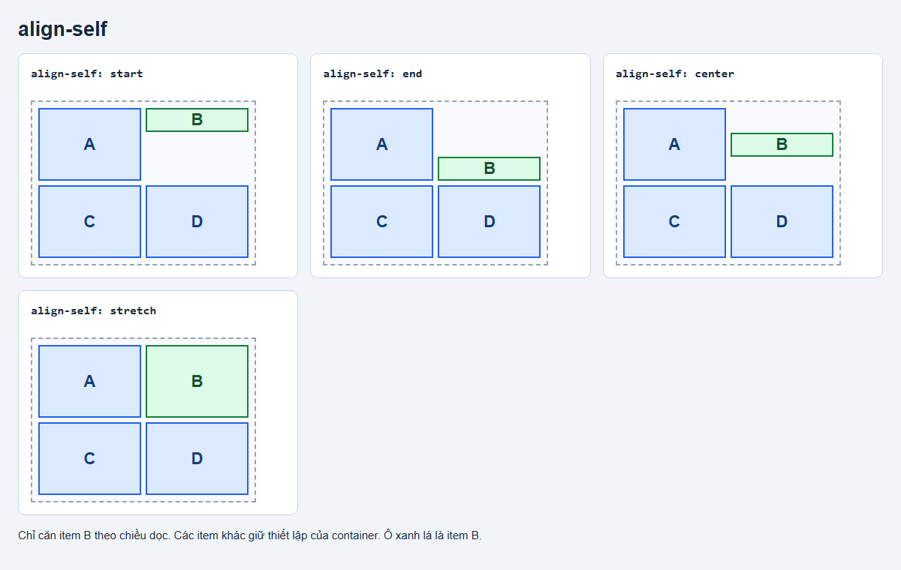

## 3. Responsive Design

### 3.1. Khái niệm

\- Responsive Design là cách xây dựng giao diện thích ứng với không gian hiển thị. Nội dung, hình ảnh và bố cục co giãn để người dùng dễ đọc và thao tác trên điện thoại, máy tính bảng và máy tính.

\- Một danh sách có thể chuyển từ một cột sang hai hoặc ba cột tùy chiều rộng khung chứa. Các công cụ thường dùng gồm viewport, media query, đơn vị tương đối, giới hạn kích thước và Flexbox/Grid.

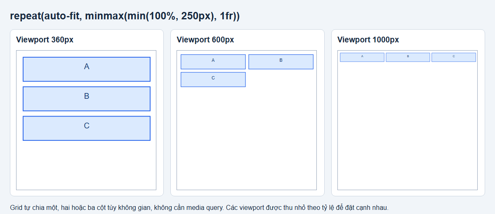

### 3.2. Thẻ Meta Viewport

\- Đặt khai báo sau trong phần `<head>` để trình duyệt di động dùng layout viewport theo chiều rộng thiết bị, tính bằng CSS pixel.

```html
<meta name="viewport" content="width=device-width, initial-scale=1.0">
```

- `width=device-width` đặt chiều rộng layout viewport theo thiết bị.
- `initial-scale=1.0` đặt mức thu phóng ban đầu là 1, tương ứng 100%.

\- Khi thiếu viewport phù hợp, trình duyệt di động có thể dùng một layout viewport rộng rồi thu nhỏ toàn trang, khiến chữ và nội dung khó đọc.

### 3.3. Media Queries

\- Media query cho phép áp dụng CSS khi điều kiện về môi trường hiển thị được đáp ứng. Các điều kiện về `width` và `height` xét kích thước viewport. Breakpoint là ngưỡng tại đó bố cục cần thay đổi.

#### 3.3.1. `max-width` — Áp dụng đến một giới hạn

\- Điều kiện đúng khi viewport có chiều rộng nhỏ hơn hoặc bằng giá trị chỉ định. Cách này thường được dùng khi viết giao diện rộng trước rồi thu gọn dần, gọi là **Desktop-First**.

```css
.container {
    display: grid;
    grid-template-columns: repeat(3, minmax(0, 1fr));
    gap: 1rem;
}

@media (max-width: 768px) {
    .container {
        grid-template-columns: minmax(0, 1fr);
    }
}
```

- Trên `768px` hiển thị ba cột.
- Từ `768px` trở xuống hiển thị một cột, bao gồm đúng mốc `768px`.

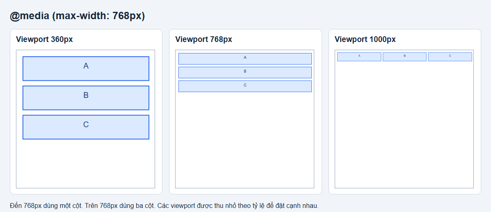

#### 3.3.2. `min-width` — Áp dụng từ một giới hạn

\- Điều kiện đúng khi viewport có chiều rộng lớn hơn hoặc bằng giá trị chỉ định. Cách này thường được dùng khi viết giao diện hẹp trước rồi mở rộng dần, gọi là **Mobile-First**.

```css
.container {
    display: grid;
    grid-template-columns: minmax(0, 1fr);
    gap: 1rem;
}

@media (min-width: 768px) {
    .container {
        grid-template-columns: repeat(3, minmax(0, 1fr));
    }
}
```

- Dưới `768px` hiển thị một cột.
- Từ `768px` hiển thị ba cột.

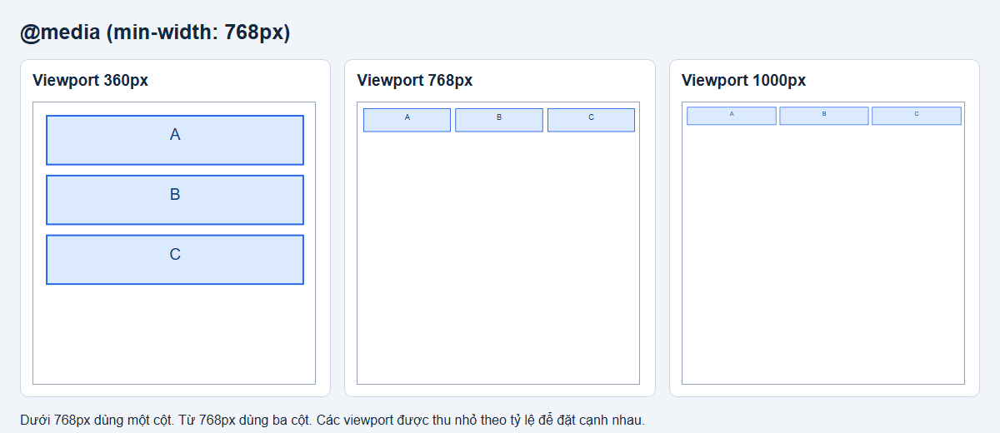

#### 3.3.3. Chọn Breakpoint

\- Các mốc tham khảo thường gặp gồm `576px`, `768px`, `992px` và `1200px`. Chọn điểm ngắt theo lúc nội dung bắt đầu chật, tràn hoặc khó đọc. Kiểm tra cả các độ rộng nằm giữa những mốc này.

\- Có thể kết hợp điều kiện để giới hạn một khoảng chiều rộng.

```css
@media (min-width: 576px) and (max-width: 991px) {
    .page-title {
        font-size: 2rem;
    }
}
```

### 3.4. Các đơn vị đo lường linh hoạt

#### 3.4.1. `%` — Tỷ lệ theo mốc tham chiếu

\- Mốc tính phần trăm phụ thuộc thuộc tính. Với `width`, giá trị thường được tính theo chiều rộng khối chứa.

```css
.column {
    width: 50%;
}
```

\- Nếu khối chứa rộng `600px`, phần chiều rộng này bằng `300px`, trước khi xét cách tính padding và border theo Box Model.

#### 3.4.2. `vw` và `vh` — Tỷ lệ theo viewport

- `1vw` bằng 1% chiều rộng viewport.
- `1vh` bằng 1% chiều cao viewport theo cách xác định đơn vị viewport của trình duyệt.
- `50vw` bằng một nửa chiều rộng viewport, dù khối chứa của phần tử hẹp hơn.

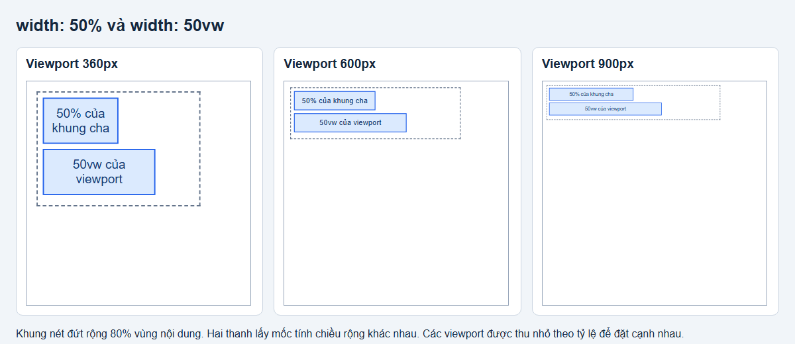

\- Trên thiết bị di động, vùng nhìn có thể đổi khi thanh trình duyệt ẩn hoặc hiện. Có thể dùng `min-height: 100dvh` khi muốn theo chiều cao viewport động.

#### 3.4.3. `rem` và `em` — Tỷ lệ theo cỡ chữ

- `rem` dựa trên `font-size` của phần tử gốc `<html>`.
- `em` trong `font-size` dựa trên cỡ chữ kế thừa, thường từ cha.
- `em` trong `padding` và `margin` dựa trên cỡ chữ của chính phần tử.

```css
.button {
    font-size: 1rem;
    padding: 0.75em 1.5em;
}
```

\- Khi cỡ chữ nút thay đổi, padding dùng `em` thay đổi theo. Nếu cỡ chữ gốc là `16px`, `1rem` bằng `16px`.

### 3.5. Thuộc tính giới hạn kích thước

#### 3.5.1. `max-width` — Giới hạn chiều rộng tối đa

\- Kết hợp chiều rộng linh hoạt với giới hạn tối đa để khung co trên màn hình nhỏ và giữ độ rộng dễ đọc trên màn hình lớn.

```css
.container {
    width: 90%;
    max-width: 600px;
    margin-inline: auto;
}
```

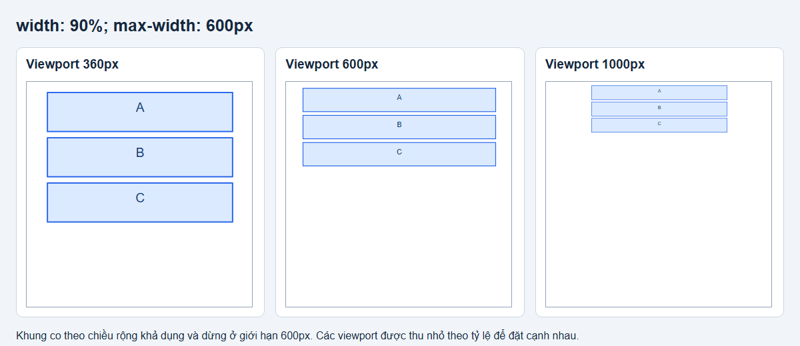

\- Với hình ảnh và video, giới hạn chiều rộng theo khung chứa và giữ tỷ lệ khi thu nhỏ.

```css
img,
video {
    display: block;
    max-width: 100%;
    height: auto;
}
```

#### 3.5.2. `min-width`, `min-height`, `max-height`

- `min-width` đặt chiều rộng tối thiểu. Ví dụ `min-width: 0` cho phép flex/grid item co nhỏ khi nội dung dài cản trở bố cục.
- `min-height` đặt chiều cao tối thiểu, vẫn cho phép vùng nội dung cao thêm.
- `max-height` đặt chiều cao tối đa. Có thể kết hợp `overflow: auto` để cuộn nội dung vượt giới hạn.

```css
.content-panel {
    min-width: 0;
    min-height: 10rem;
    max-height: 24rem;
    overflow: auto;
}
```

### 3.6. Các hàm CSS và bố cục tự co giãn

#### 3.6.1. `clamp()` — Co giãn giữa hai giới hạn

\- Cú pháp `clamp(min, preferred, max)` gồm giới hạn nhỏ nhất, giá trị ưu tiên và giới hạn lớn nhất.

```css
.page-title {
    font-size: clamp(1rem, 2.5vw, 2rem);
}
```

\- Với cỡ chữ gốc `16px`, tiêu đề không nhỏ hơn `16px`, không lớn hơn `32px`. Trong khoảng đó, cỡ chữ đi theo `2.5vw`.

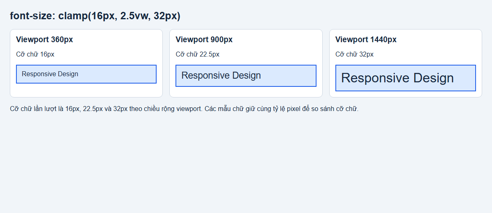

#### 3.6.2. `min()` và `max()` — Chọn một giá trị

- `min()` chọn giá trị nhỏ nhất sau khi tính các biểu thức.
- `max()` chọn giá trị lớn nhất sau khi tính các biểu thức.

```css
.container {
    width: min(90%, 1200px);
    margin-inline: auto;
}

.sidebar {
    width: max(50%, 200px);
}
```

\- Khung đầu rộng 90% khối chứa và tối đa `1200px`. Sidebar rộng ít nhất `200px`, hoặc 50% khối chứa nếu giá trị đó lớn hơn. Cần kiểm tra giới hạn tối thiểu trên màn hình hẹp để tránh tràn.

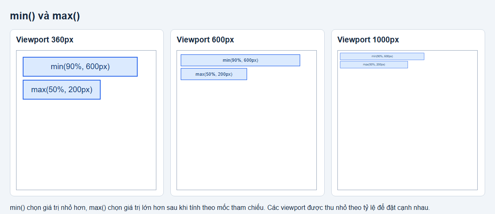

#### 3.6.3. Flexbox và Grid tự xuống dòng

\- Với Flexbox, dùng wrap và kích thước cơ sở phù hợp để item chuyển dòng khi thiếu không gian.

```css
.flex-list {
    display: flex;
    flex-wrap: wrap;
    gap: 1rem;
}

.flex-list > article {
    flex: 1 1 15rem;
    min-width: 0;
}
```

\- Với Grid, kết hợp `auto-fit` và `minmax()` để tự xác định số cột.

```css
.grid-list {
    display: grid;
    grid-template-columns: repeat(auto-fit, minmax(min(100%, 250px), 1fr));
    gap: 1rem;
}
```

- `auto-fit` tạo số cột phù hợp với không gian và thu gọn các track trống.
- `min(100%, 250px)` cho phép cột vừa khung ngay cả khi khung hẹp hơn `250px`.
- `1fr` giúp các cột đang dùng chia đều không gian còn lại.


### 3.7. Kiểm tra giao diện Responsive

\- Mở DevTools và bật chế độ mô phỏng thiết bị, thử ở màn hình hẹp, vừa và rộng. Kéo thay đổi chiều rộng liên tục để phát hiện vấn đề ở khoảng giữa các breakpoint.

- Nội dung dễ đọc, các nút và liên kết dễ thao tác.
- Ảnh và video nằm trong khung, giữ tỷ lệ.
- Văn bản dài xuống dòng phù hợp.
- Trang không xuất hiện thanh cuộn ngang ngoài ý muốn.
- Bố cục đổi đúng tại breakpoint và hai phía của breakpoint.
