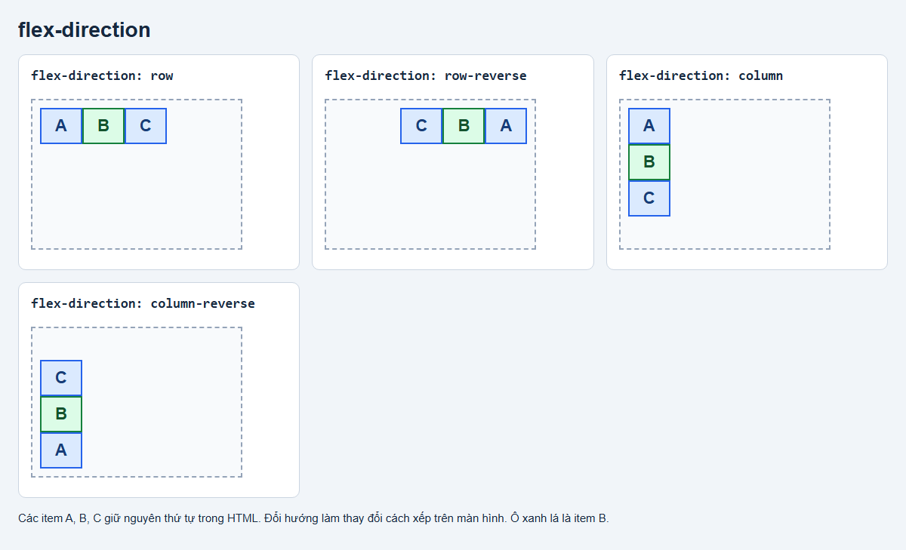
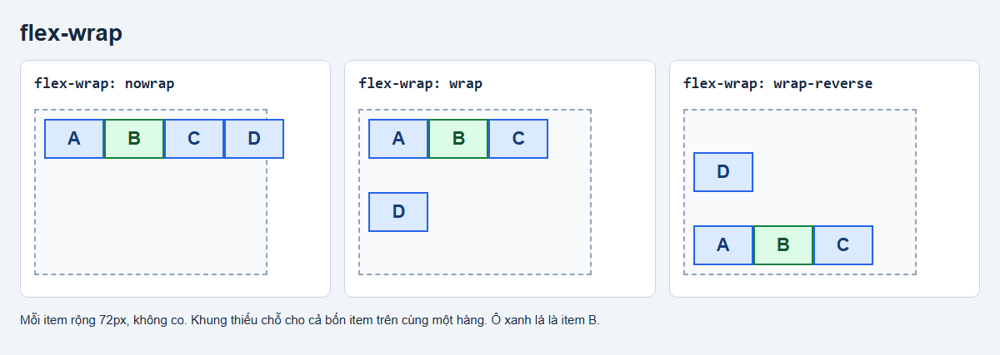
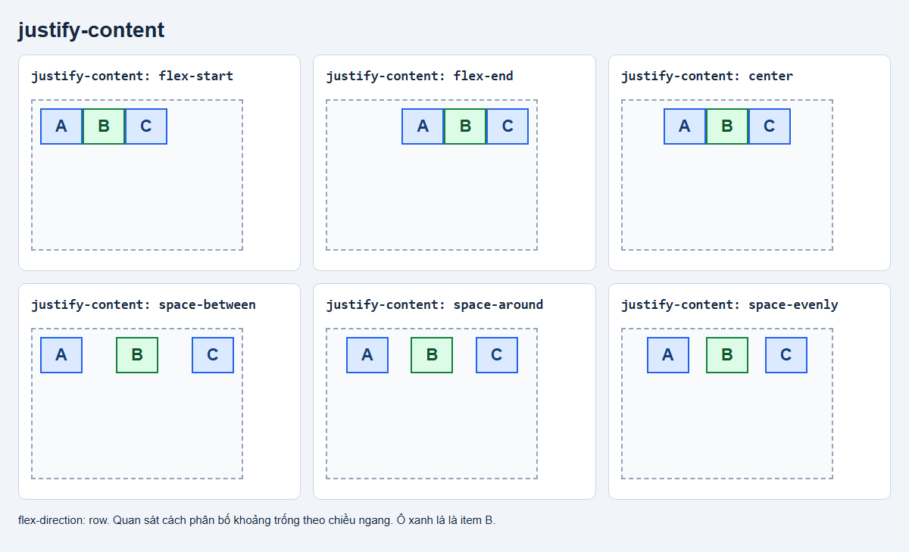
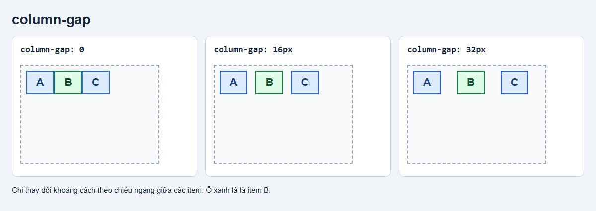
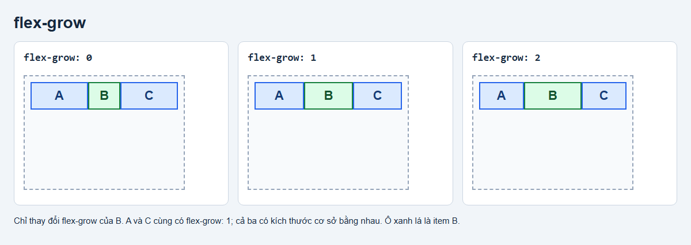
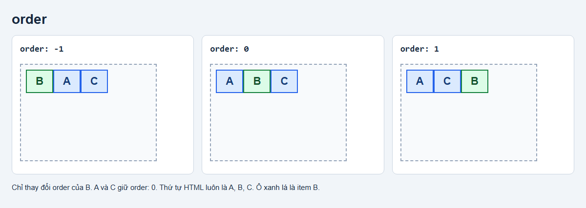

# [Buổi 5: Flexbox, Grid và Responsive Design](https://thienbao28287.github.io/WEB_PRIVATE_2026/#/Lesson5/theory?section=buoi-5-flexbox-grid-va-responsive-design)

## 1. Flexbox

### 1.1. Khái niệm

Flexbox (viết tắt của Flexible Box Layout) là mô hình bố cục một chiều trong CSS, giúp sắp xếp, căn chỉnh và phân phối không gian giữa các phần tử bên trong một vùng chứa một cách linh hoạt, ngay cả khi kích thước của chúng chưa biết trước hoặc thay đổi.

Phần tử cha được gọi là **Flex Container**. Các phần tử con trực tiếp bên trong được gọi là **Flex Items**.

**Main Axis** là trục chính mà các phần tử con xếp theo. **Cross Axis** là trục phụ, vuông góc với trục chính.

### 1.2. Thuộc tính cho Flex Container (phần tử cha)

Để kích hoạt Flexbox, đặt `display: flex;` hoặc `display: inline-flex;` cho phần tử cha. Các hướng dưới đây xét theo cách viết thông thường từ trái sang phải, từ trên xuống dưới.

#### 1.2.1. `display` — Kích hoạt Flexbox

Kích hoạt môi trường Flexbox. Hai giá trị thường dùng là `flex` và `inline-flex`.

#### 1.2.2. `flex-direction` — Hướng sắp xếp

Xác định hướng của trục chính mà các phần tử con xếp theo.

- `row` (mặc định) xếp ngang từ trái sang phải.
- `row-reverse` xếp ngang từ phải sang trái.
- `column` xếp dọc từ trên xuống dưới.
- `column-reverse` xếp dọc từ dưới lên trên.

#### 1.2.3. `flex-wrap` — Xuống dòng

Quy định các phần tử con có tạo dòng mới khi thiếu không gian hay không.

- `nowrap` (mặc định) giữ các phần tử trên một dòng flex. Chúng có thể co lại hoặc tràn khi thiếu chỗ.
- `wrap` cho phép tạo dòng mới. Với `row`, các hàng mới nằm phía dưới.
- `wrap-reverse` cho phép tạo dòng mới về phía ngược lại. Với `row`, các hàng mới nằm phía trên.

#### 1.2.4. `justify-content` — Căn theo trục chính

Căn chỉnh và phân bố các phần tử con theo trục chính. Với `row`, thuộc tính này căn theo chiều ngang. Với `column`, thuộc tính này căn theo chiều dọc.

- `flex-start` dồn các phần tử về đầu trục, là cách căn mặc định thông thường.
- `flex-end` dồn các phần tử về cuối trục.
- `center` căn giữa nhóm phần tử.
- `space-between` đặt phần tử đầu và cuối sát hai mép, chia đều khoảng trống giữa các phần tử.
- `space-around` tạo khoảng trống hai bên mỗi phần tử. Khoảng giữa hai phần tử gấp đôi khoảng ở mép ngoài.
- `space-evenly` tạo khoảng trống bằng nhau giữa các phần tử và ở hai mép ngoài.

Cần có không gian còn lại theo trục chính để thấy rõ hiệu ứng phân bố.

#### 1.2.5. `align-items` — Căn theo trục phụ

Căn các phần tử con theo trục phụ trong từng dòng flex. Với `row`, thuộc tính này căn theo chiều dọc. Với `column`, thuộc tính này căn theo chiều ngang.

- `stretch` là hành vi mặc định thông thường, kéo giãn phần tử theo trục phụ nếu kích thước theo trục đó là `auto`.
- `flex-start` căn về đầu trục phụ, thường là phía trên với `row` hoặc bên trái với `column`.
- `flex-end` căn về cuối trục phụ, thường là phía dưới với `row` hoặc bên phải với `column`.
- `center` căn giữa theo trục phụ.
- `baseline` căn các phần tử theo đường chân chữ của nội dung bên trong.

#### 1.2.6. `gap`, `row-gap`, `column-gap` — Khoảng cách

Tạo khoảng cách giữa các phần tử và các dòng flex.

- `gap: 16px;` đặt khoảng cách hàng và cột cùng bằng `16px`.
- `gap: 10px 20px;` đặt `row-gap` bằng `10px` và `column-gap` bằng `20px`.
- Với `row`, ví dụ trên tạo khoảng cách giữa các hàng là `10px`, giữa các phần tử trong hàng là `20px`.
- Với `column`, khoảng cách giữa các phần tử trong cột là `10px`, giữa các cột là `20px`.

### 1.3. Thuộc tính cho Flex Items (phần tử con)

Các thuộc tính dưới đây áp dụng trực tiếp lên từng flex item.

#### 1.3.1. `flex-grow` — Giãn rộng

Xác định hệ số nhận thêm không gian khi phần tử cha còn chỗ trống. Mặc định là `0`, phần tử không nhận thêm không gian dư. Item có grow bằng `2` nhận phần không gian dư gấp đôi item có grow bằng `1`, nếu các giới hạn kích thước cho phép.

#### 1.3.2. `flex-shrink` — Co lại

Xác định hệ số co lại khi phần tử cha thiếu không gian. Mặc định là `1`. Mức co thực tế phụ thuộc cả hệ số này và kích thước cơ sở của phần tử. Giá trị `0` giữ phần tử khỏi co theo cơ chế shrink.

#### 1.3.3. `flex-basis` — Kích thước cơ sở

Thiết lập kích thước cơ sở theo trục chính trước khi phân chia không gian. Với `row`, kích thước này theo chiều ngang. Với `column`, kích thước này theo chiều dọc. Mặc định là `auto`.

#### 1.3.4. `flex` — Viết gộp grow, shrink và basis

Viết gộp ba thuộc tính theo thứ tự `flex-grow flex-shrink flex-basis`. Ví dụ `flex: 1 1 200px;` đặt basis `200px`, cho phép giãn và co với hệ số `1`.

`flex: 1;` được trình duyệt mở rộng thành `1 1 0%`. Khi các item cùng dùng giá trị này và có điều kiện padding, border, min/max-size tương đương, chúng thường chia đều không gian theo trục chính.

#### 1.3.5. `align-self` — Căn riêng từng item

Cho phép một phần tử căn riêng theo trục phụ, ghi đè cách căn từ `align-items` của cha. Các giá trị thường dùng gồm `auto`, `flex-start`, `flex-end`, `center`, `baseline` và `stretch`. Mặc định `auto` dùng cách căn của cha.

#### 1.3.6. `order` — Thứ tự hiển thị

Thay đổi thứ tự hiển thị của phần tử con. Mặc định là `0`, số nhỏ hơn được xếp trước. Nếu cùng giá trị, các phần tử giữ thứ tự trong HTML. Khi sử dụng, cần giữ thứ tự nội dung HTML hợp lý cho việc đọc và di chuyển bằng bàn phím.

